# How context works in Sigil

This page explains what Sigil sends to the model on every request, what it
leaves out, and how it measures the difference. Read it before changing a
context strategy or debugging a turn that "forgot" what the agent did.

The short version: **the session log keeps everything, but the model only ever
sees a projection of it.** Keeping the log intact is what makes the session
resumable; projecting it is what keeps the request inside the window.

- [The two things that exist](#the-two-things-that-exist)
- [The pipeline of one request](#the-pipeline-of-one-request)
- [The budget](#the-budget)
- [The three levers](#the-three-levers)
- [Reasoning: a window of steps](#reasoning-a-window-of-steps)
- [Tokens: measured versus projected](#tokens-measured-versus-projected)
- [What travels and what does not](#what-travels-and-what-does-not)
- [Strategies](#strategies)
- [Configuration](#configuration)
- [Inspecting a session](#inspecting-a-session)
- [Invariants](#invariants)

## The two things that exist

There are two distinct message lists, and confusing them is the source of most
bugs in this area.

| | The log | The view |
| --- | --- | --- |
| What it is | Every message the run produced, in order | The subset that goes to the model on the next request |
| Where it lives | `ctx.messages`, returned by `run.all_messages()` | `request_context.messages` |
| Persisted | Yes, to the session file | No |
| Modified by the strategy | Never | Yes, on every request |

The capability that applies the strategy is **deliberately non-destructive**: it
only reassigns `request_context.messages`, which is a list owned by the request.
It never mutates `ctx.messages`, so the log survives a turn that was trimmed,
and a resumed session still has the whole conversation on disk.

This is why the project does not use pydantic-ai's `ProcessHistory`: that
capability does `ctx.messages[:] = ...` and rewrites the persistent history.

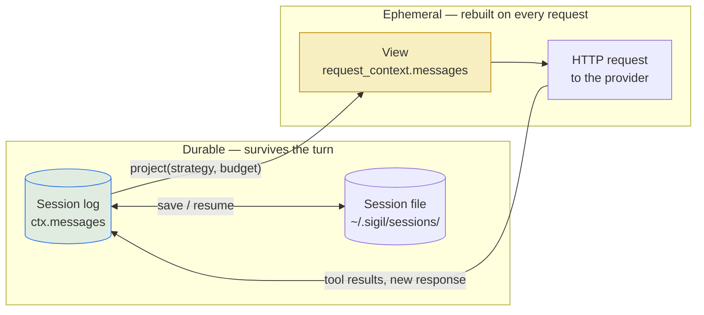

## The pipeline of one request

`ContextViewCapability.before_model_request` runs once per model request, which
means **once per step**, not once per turn. A single turn with thirty tool calls
runs it thirty times.

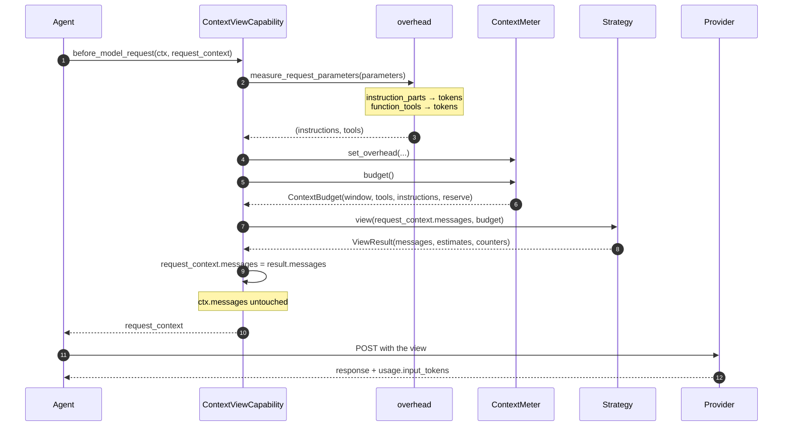

The order matters: the overhead is measured **before** the budget is built,
because the budget is derived from it. Instructions and tool schemas are
measured from `ModelRequestParameters`, which is the source of truth of what
actually gets sent —not by introspecting the agent.

## The budget

The model window is not all available for the conversation. Three blocks are
subtracted before the history gets anything:

```text
window
  − tools (schemas)        measured, usually the largest fixed block
  − instructions (blocks)  measured
  − output (max_tokens)    reserved, so the answer is not cut off
  = available for history
```

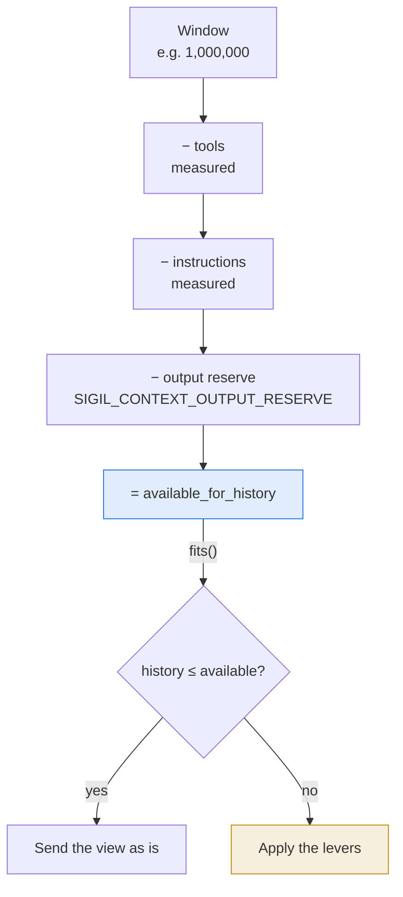

`ContextBudget` also handles the case where the window is unknown: with
`window=None`, `available_for_history` is `None` and `fits()` returns `None`.
In that state no strategy drops anything — a model without a declared window
is never trimmed blind.

## The three levers

`WindowedStrategy` applies three levers, ordered from cheapest to most
destructive. The first two are free in terms of information; the third is the
only one that loses messages.

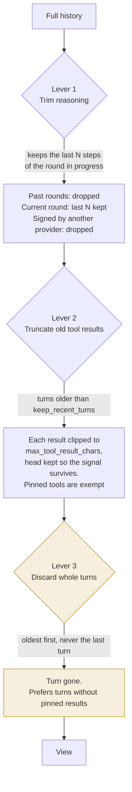

Reasoning is the first lever because it is the cheapest thing to lose. It is also
the one that is not all-or-nothing: see
[Reasoning: a window of steps](#reasoning-a-window-of-steps).

### Why whole turns

A turn is self-contained by construction: `prompt → responses → tool calls →
tool returns`. Discarding it whole is the only way to avoid leaving an orphan
`ToolReturnPart`, which providers reject with a 400.

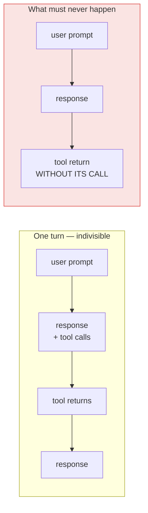

`split_turns` puts `keep_recent_turns` turns aside before trimming starts, and
`fit_to_budget` stops when only one turn is left. The current turn is never
discarded while the agent is working in it.

### Why some tool results are pinned

`PINNED_TOOLS` (`load_skill`, `read_skill_resource`) hold **instructions, not
data**. A skill body is what the agent must keep complying with; truncating it
to a stub or collapsing it into `load_skill -> ok` removes the instructions
mid-task. They are never truncated and never compacted, and when turns have to
be discarded, turns without pinned results go first.

## Tokens: measured versus projected

Two numbers exist and they must not be confused.

| | Measured | Projected |
| --- | --- | --- |
| Source | `usage.input_tokens` the provider reported | measured + estimate of what was added since |
| Accuracy | ground truth | an estimate, biased low |
| Describes | the request that was already sent | the request about to be sent |

The estimator is `chars / 4` (`CHARS_PER_TOKEN`). It is a heuristic with a
known bias, and the bias is fine because of *how* it is used:

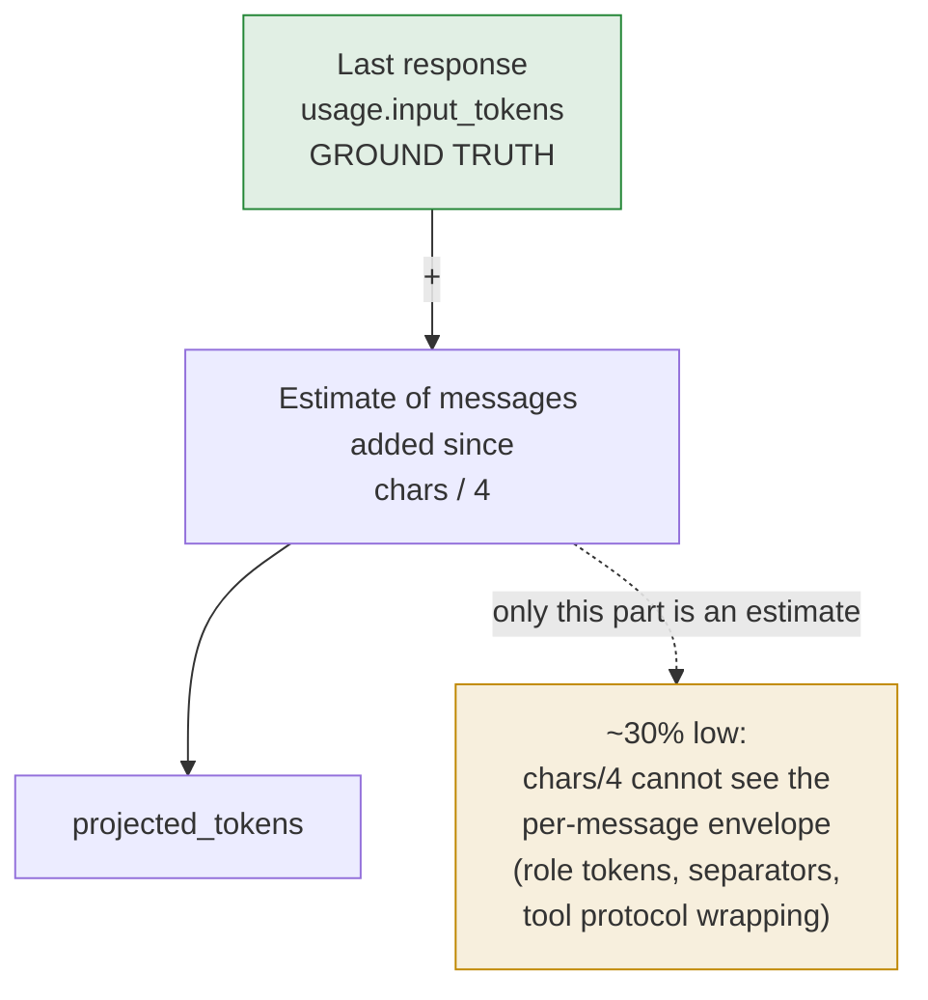

The projection is anchored on the measured value and **only the delta is
estimated**. The envelope of the messages already included in the measurement
is already inside the number the provider returned, so the bias does not
accumulate over the conversation.

Measured against a real session, the ratio between the estimate and what the
provider billed is stable:

| Method | Ratio to the billed input |
| --- | --- |
| `chars / 4` | ~0.69 |
| `tiktoken` (`o200k_base`) | ~0.76 |

A real tokenizer closes a few points and costs ~77 ms per call over a
300k-token history, on a function that runs on every step. It was measured and
rejected: the remaining gap is the protocol envelope, which no tokenizer over
the message text can see. The estimator only has to be consistent enough to
compare blocks and project a delta.

### The instructions trap

A saved `ModelRequest` keeps the instructions it was made with, in its
`instructions` field. **They are not resent.** pydantic-ai sends the
instructions of the request being made, resolved into
`model_request_parameters.instruction_parts`, and the ones recorded on earlier
messages only document what that request was made with.

Counting them per message made a measured session estimate at **12× its real
weight** at the point where the trimming ran (5.1M against 425k). The surplus
pushed the history over the budget and `fit_to_budget` discarded a whole turn
—the model then reported "my context has no prior conversation" and re-explored
the workspace from scratch while the log still held everything.

In that session, 451 of the saved requests carried the same 34,520 characters of
instructions —8,630 tokens each— none of which were resent.

`estimate_message_tokens` therefore counts **parts only**. What the instructions
cost on the current request is measured once, from the parameters, and travels
in `ContextBudget.instructions`.

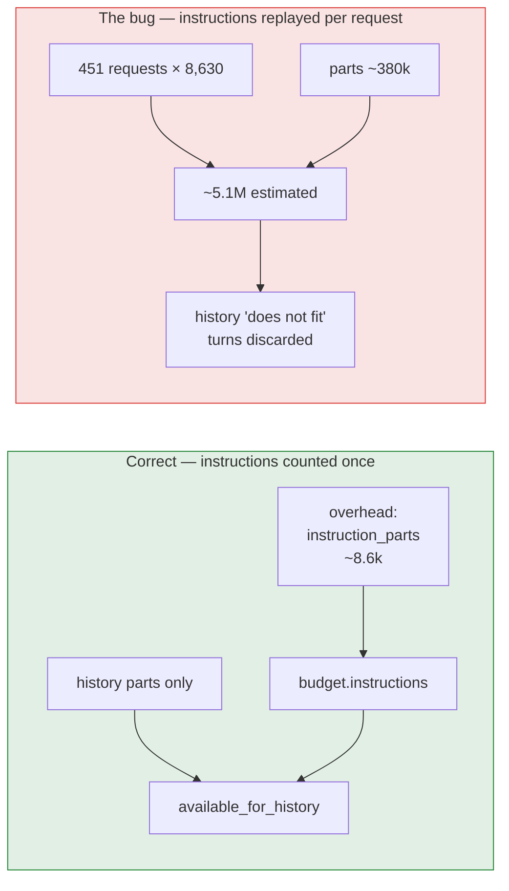

## What travels and what does not

Each request carries more than the message text. Knowing which parts are
resent and which are recorded is what makes the estimate correct.

| Element | Travels on the next request? | Counted in the history estimate? |
| --- | --- | --- |
| `UserPromptPart`, `TextPart` | yes | yes |
| `ToolCallPart` (name + args) | yes | yes |
| `ToolReturnPart` | yes, unless truncated or discarded | yes |
| `ThinkingPart` | the last N steps of the round in progress | only what is sent |
| `instructions` of past requests | **no** | **no** (bug fixed) |
| `instructions` of the current request | yes | via `ContextBudget` |
| Tool schemas | yes, on every request | via `ContextBudget` |
| Provider envelope | yes | no — invisible to any text estimate |

## Reasoning: a window of steps

Reasoning is not resent to the model by default, and that blanket rule had a
measurable cost. While the agent is **inside** a round, it re-reads its own
reasoning step after step. In a measured session, 38 of the 77 reasoning blocks of
one round —76% of its volume— were the model re-deciding the same ambiguity:
whether "I uploaded those changes" meant it had, or that it should. It could not
see that it had already answered, so it asked itself again for 110 steps.

What fixes that is the reasoning of the steps next to the work in progress. What a
round's reasoning is not, is a record worth its price: it is resent on every
request.

### A round, a step, a window

| Term | Meaning |
| --- | --- |
| **Round** | Everything until control goes back to the user: one `run_id`. A prompt typed while the agent works is enqueued into the same run, so steering does not open a new round. |
| **Step** | One model request and its response, inside a round. |
| **Window** | How many steps of the round in progress keep their reasoning. `SIGIL_CONTEXT_REASONING_STEPS`, default 10. |
| **Cap** | The most reasoning that window may cost, in tokens: the smaller of a share of the model window (`SIGIL_CONTEXT_REASONING_MAX_PERCENT`, default 10%) and the room the history has left. |

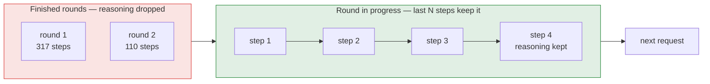

### The handoff, and why the first request of a round is different

A new round has no response yet, so the most recent round *in the history* is the
previous one. The window therefore lands on the last steps of the round that just
ended — which is the handoff: what the agent concluded before it handed control
back. As soon as the new round answers, its own steps take over and the previous
round becomes a record again.

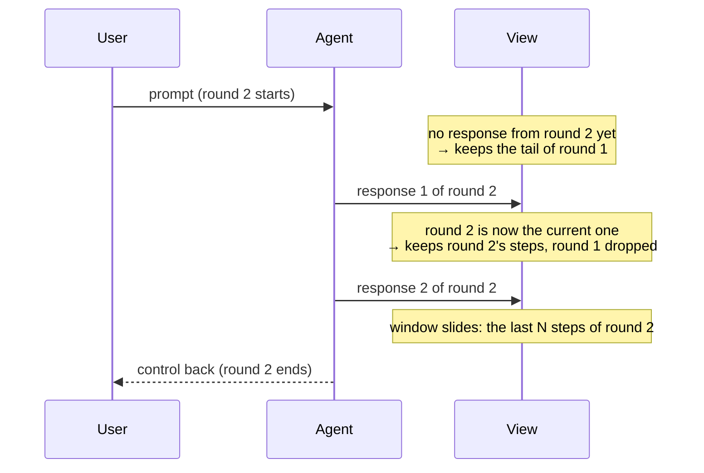

The window is on steps and not on the whole round because resending a round is
quadratic: each request carries every reasoning block produced so far in it.

| Round | Steps | Reasoning blocks | Extra billed if the whole round is resent |
| --- | --- | --- | --- |
| 1 | 317 | 198,525 tokens | **44.1M tokens** |
| 2 | 110 | 128,577 tokens | **9.1M tokens** |
| 3 | 24 | 3,877 tokens | 51k tokens |

A window of steps costs `K × tamaño_de_paso`, linearly. The loop it prevents
(re-deciding what was already decided) is local to a few steps, which is where a
window belongs.

### Signed reasoning belongs to its provider

`ThinkingPart.signature` is not Anthropic-only: Anthropic, Bedrock, Google and
OpenAI all sign reasoning, and a signature is only sent back to the provider that
produced it. Keeping a signed block for a different receiver spends history on
something the adapter has to render as plain text anyway.

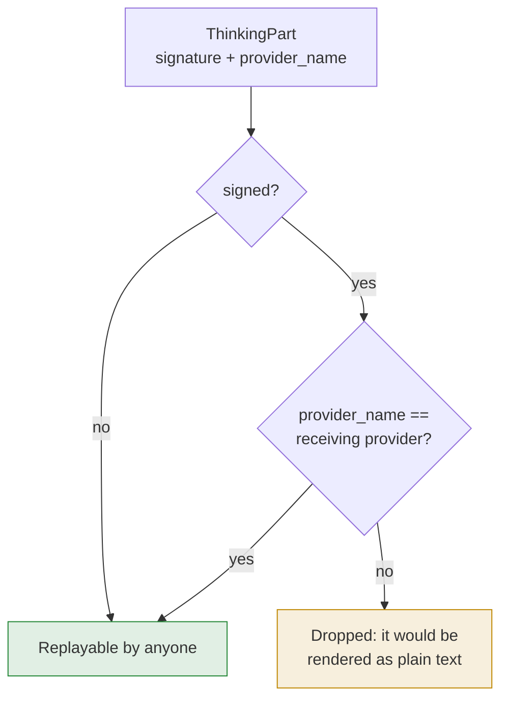

The receiving provider is read per request, not at startup: the model can be
swapped mid-session and the strategy is built once. When the provider is unknown,
the check is skipped rather than guessed — a wrong guess drops reasoning that was
fine.

### Reasoning is a lever, not a guarantee

Keeping it never costs a turn. If the reasoning the policy kept does not fit the
budget, the window shrinks step by step until it does; tool results are truncated
and turns discarded only after all reasoning is gone.

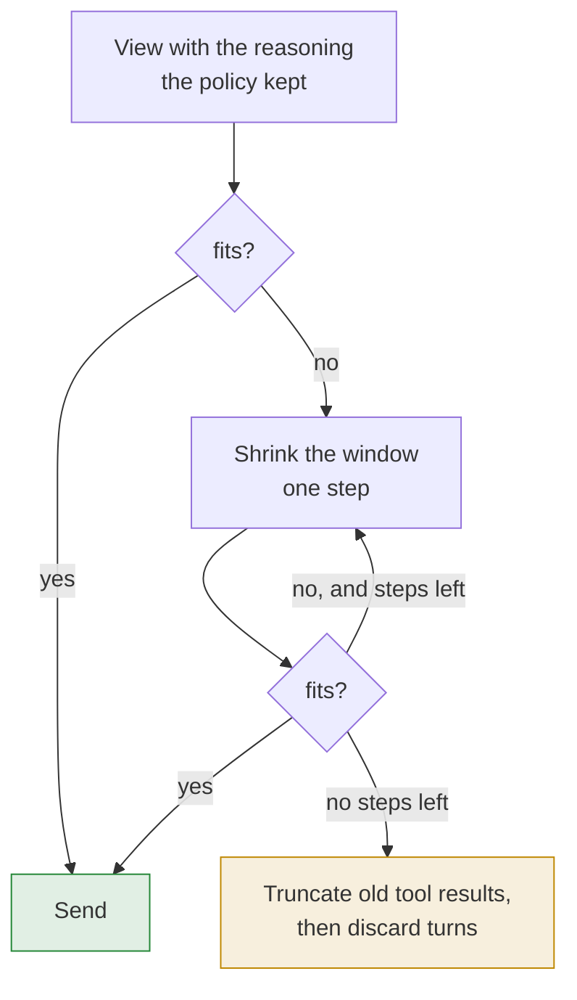

### The cap: a wide window must not be a stupid one

A step count alone is either too small to help or too large to be safe. Ten steps
of a model that thinks in 5k tokens is 50k, every request; the same ten steps in a
context with 8k left is the whole turn.

So the window has a ceiling, and the ceiling is the **smaller** of two numbers:

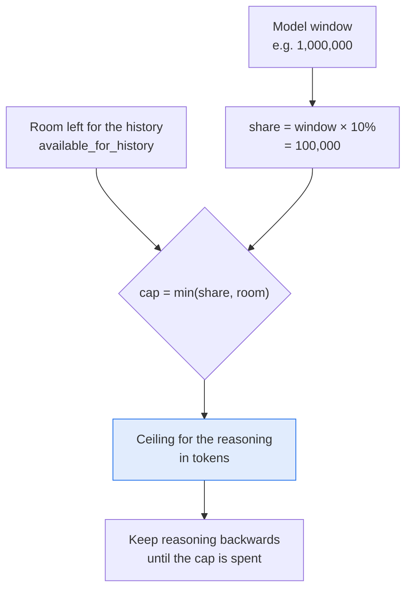

- **The share** stops reasoning from becoming a standing tax: on a 1M window it can
  never exceed 100k, however long the round gets.
- **The room** stops it from starving the turn it is meant to help: with 8k left,
  the cap is 8k, not 100k.

When the window is unknown there is no cap and the step count is the only limit:
without a budget there is nothing to spend against.

The blocks are taken newest first, so the ones that survive are the closest to the
work in progress. A block that does not fit ends the search, because the ones
further back cost the same or more.

In a measured session the cap never binds: ten steps of reasoning cost about 2.7k
tokens against a 100k ceiling. It exists for the case that is not measured yet —a
model that thinks in tens of thousands of tokens per step— and for a context that
is nearly full, where it is the difference between keeping some reasoning and
losing a turn.

### Images: priced by pixels, dropped with their turn

An image is the most expensive item in the history per unit of usefulness, and the
estimator used to be blind to it: the content of a multimodal prompt is a list, and
`str(BinaryContent)` is a forty-character repr, so a 4K screenshot was counted as ten
tokens. A conversation with six screenshots looked like it fit when it did not, and
the request failed at the provider, mid-turn.

`part_tokens` prices an image from its encoded header —dimensions, then the same
patch arithmetic the attachment used before sending it— so no decode is needed. That
matters because the meter walks the whole history on every step.

Images are **not** kept forever:

| Where the image is | What happens |
| --- | --- |
| In a turn within `keep_recent_turns` | Sent as is |
| In an older turn | Dropped, and the text is kept with a note saying it was there and how to get it back |
| In a compacted turn | Gone with the turn; the summary keeps the intent, not the pixels |

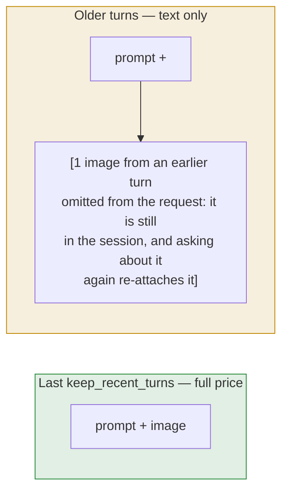

Two properties matter: the session log keeps every image (dropping is a projection,
like everything else here), and the model is told an image existed — so it knows the
conversation happened and can ask for the picture again instead of pretending the
text was all there was.

## Strategies

Selected with `SIGIL_CONTEXT_STRATEGY`. All three share the same contract:
`view(messages, budget) -> ViewResult`.

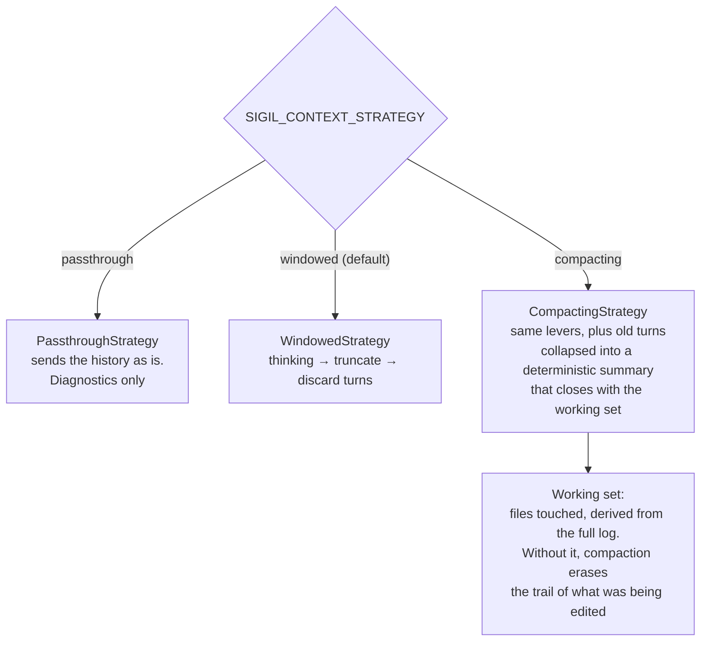

`CompactingStrategy` does not discard old turns: it replaces each one with a
`CompactionPart` holding the intent and the tool trail, without payloads. Turns
carrying a pinned result are left intact. This is still a projection —the log is
not touched.

## Configuration

| Variable | Default | Effect |
| --- | --- | --- |
| `SIGIL_CONTEXT_STRATEGY` | `windowed` | `windowed`, `compacting` or `passthrough` |
| `SIGIL_CONTEXT_KEEP_RECENT_TURNS` | `3` | Turns kept intact before trimming starts |
| `SIGIL_CONTEXT_MAX_TOOL_RESULT_CHARS` | `4000` | Cap of an old tool result |
| `SIGIL_CONTEXT_OUTPUT_RESERVE` | `8000` | Tokens reserved for the answer |
| `SIGIL_CONTEXT_REASONING` | `recent` | What travels back of the model's reasoning: `recent`, `off` or `all` |
| `SIGIL_CONTEXT_REASONING_STEPS` | `10` | Steps of the round in progress kept under `recent` |
| `SIGIL_CONTEXT_REASONING_MAX_PERCENT` | `10` | Ceiling for that reasoning, as a percentage of the model window |
| ~~`SIGIL_CONTEXT_KEEP_THINKING`~~ | — | Deprecated by `SIGIL_CONTEXT_REASONING`; truthy still means `all` |

The policy is always a name, never a number: a count was a mode once, and reading
`4` as "keep four steps" next to `1` as "keep everything" was a trap. The step
count is its own setting, and it is a quantity, not a mode.

`all` exists because some routes require round-tripping the reasoning before they
will answer. It is the expensive option, not the recommended one.

## Inspecting a session

`/context` renders the report for the current session: measured versus
projected, the budget split, the cost of each turn, and the heaviest tool
results. The debug view builds the same projection the agent would send *now*,
which is why it calls `project()` rather than reading the last `ViewResult`.

To check a saved session without opening the UI:

```python
import json

from pydantic_ai.messages import ModelMessagesTypeAdapter

from src.engine.context.budget import ContextBudget
from src.engine.context.strategy.turns import split_turns
from src.engine.context.strategy.windowed import WindowedStrategy
from src.engine.context.tokens import estimate_messages_tokens

path = '~/.sigil/sessions/<id>/<run>.json'
messages = ModelMessagesTypeAdapter.validate_python(json.load(open(path))['messages'])

budget = ContextBudget(window=1_000_000, tools=12_000, instructions=8_000, output_reserve=8_000)
result = WindowedStrategy().view(messages, budget)

print(f'turns: {len(split_turns(messages))}')
print(f'estimated: {estimate_messages_tokens(messages):,} of {budget.available_for_history:,}')
print(f'dropped messages: {result.dropped_messages}')
```

If `dropped_messages` is not zero while the real content fits, the estimate is
inflating something that does not travel. Check the table in
[What travels and what does not](#what-travels-and-what-does-not).

## Invariants

These are the properties the implementation guarantees. A change that breaks
one of them is a regression, not a trade-off.

1. **The log is never mutated.** The strategy only reassigns
   `request_context.messages`. `run.all_messages()` and the session file keep
   the full conversation.
2. **The current turn is never discarded.** Trimming stops at one turn, and
   `keep_recent_turns` keeps the last ones intact.
3. **A `ToolCallPart` never loses its `ToolReturnPart`.** Turns are the unit of
   discard for exactly this reason.
4. **Reasoning of past rounds is not resent, and reasoning of the round in
   progress never costs a turn.** The window shrinks before anything else does.
5. **Pinned tool results are never truncated or compacted.** They are
   instructions, not data.
6. **Instructions are counted once per request, never per historical message.**
7. **With an unknown window, nothing is dropped.** `fits()` returns `None` and
   no lever runs.
8. **Diagnostics never break a turn.** `on_view` failures are suppressed.

## Where the code lives

| Path | Responsibility |
| --- | --- |
| `src/engine/context/capability.py` | Hooks the strategy into each request; non-destructive |
| `src/engine/context/budget.py` | Window split: tools, instructions, reserve |
| `src/engine/context/tokens.py` | Measurement and estimation |
| `src/engine/context/overhead.py` | Measures instruction parts and tool schemas |
| `src/engine/context/strategy/` | `windowed`, `compacting`, `passthrough` |
| `src/engine/context/strategy/turns.py` | Turn grouping, pinned-result detection |
| `src/engine/context/meter/` | The `/context` report and the debug view |
| `src/engine/context/instructions/` | `AGENTS.md` / `CLAUDE.md` resolution over the scope |
| `src/engine/context/scope.py` | Which directories' instructions apply |

## Next steps

- To change how much history is kept, start with
  [Configuration](#configuration) rather than the code.
- To diagnose a turn that lost context, use
  [Inspecting a session](#inspecting-a-session) and compare the estimate with
  the numbers in the `/context` report.
- To add a strategy, implement `ContextStrategy.view` and register it in
  `_build_strategy` in `src/sigil.py`.
