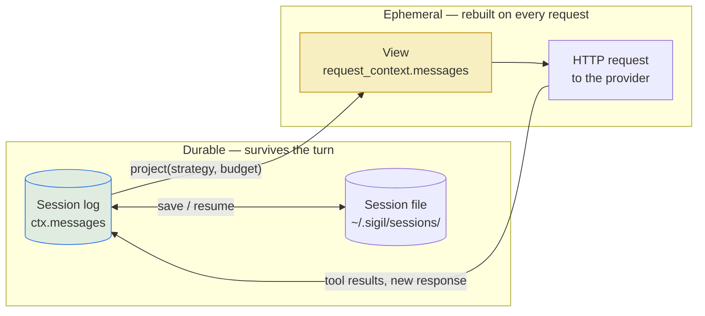
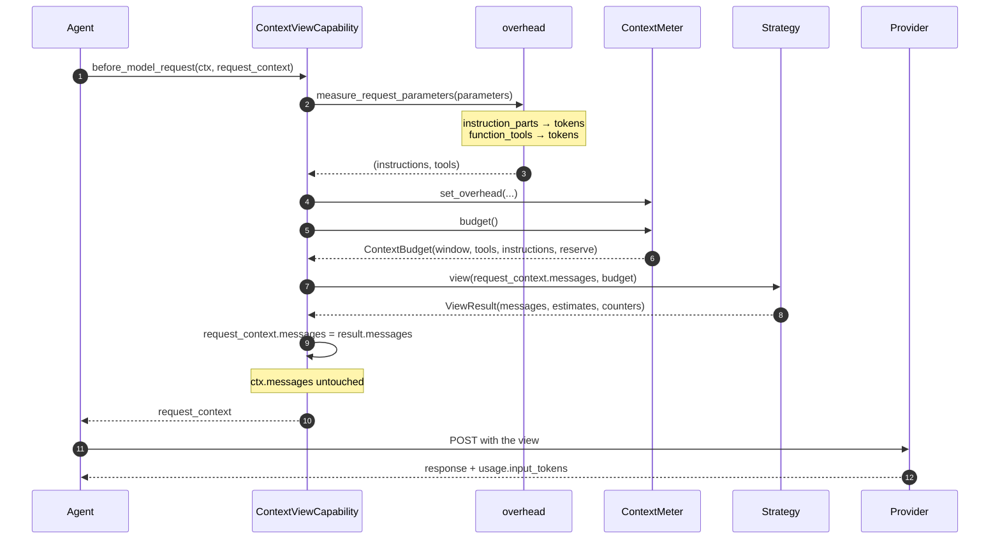
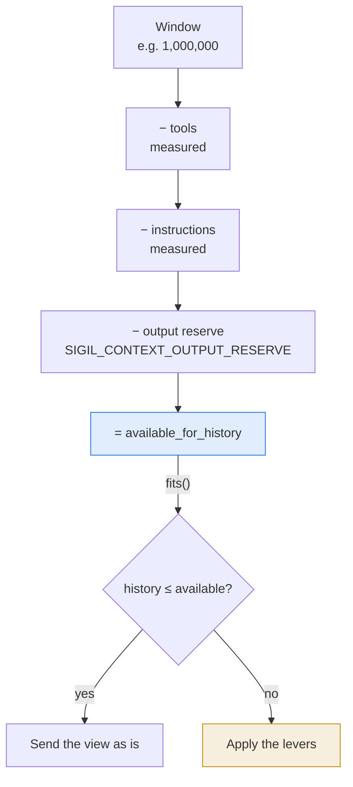
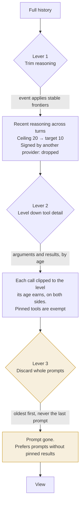
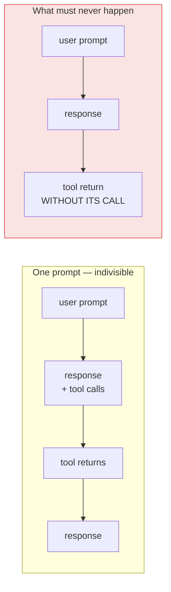
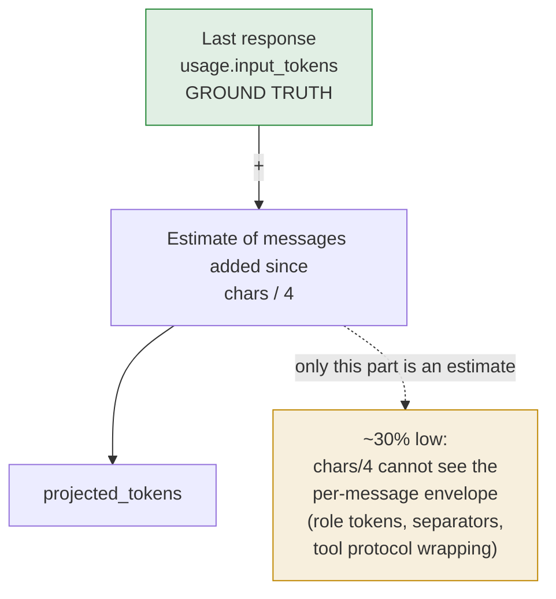
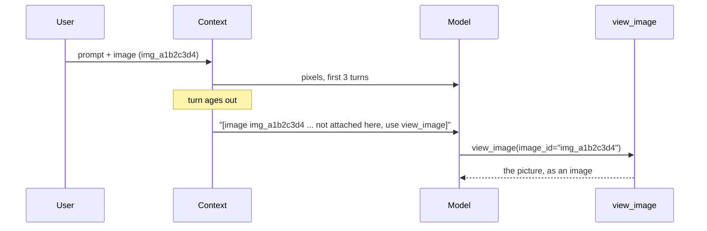
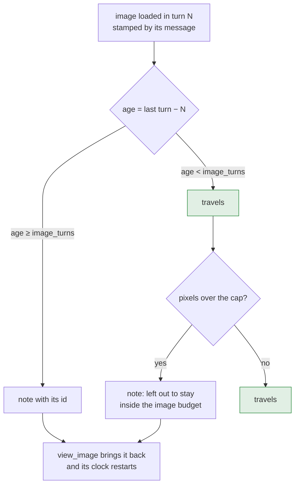
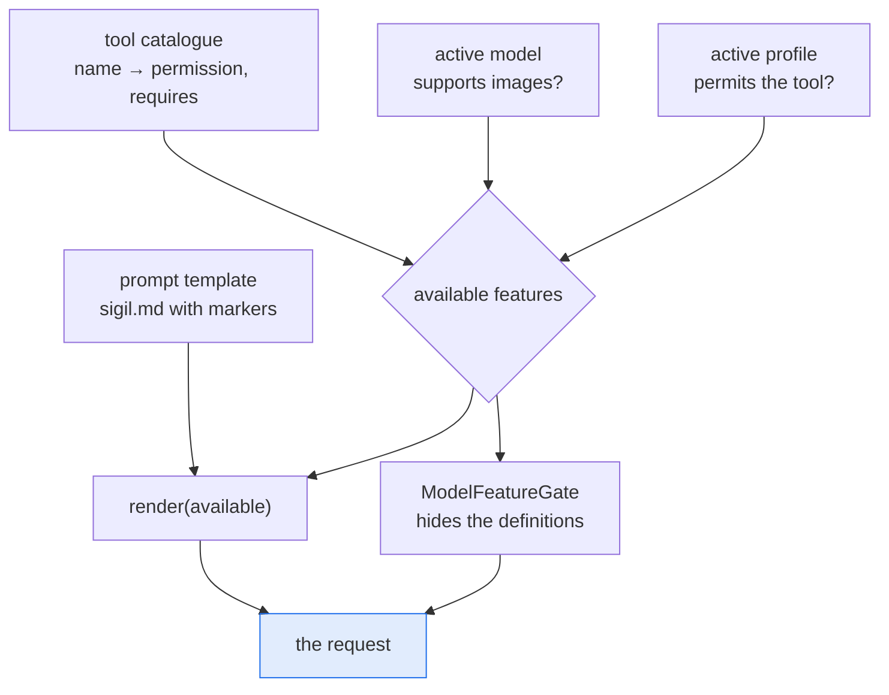
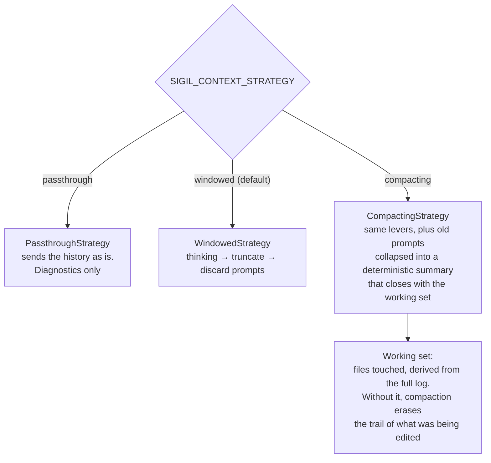

# How context works in Sigil

This page explains what Sigil sends to the model on every request, what it
leaves out, and how it measures the difference. Read it before changing a
context strategy or debugging a turn that "forgot" what the agent did.

Three words carry the whole page, and they are [the domain](domain.md)'s: a
**turn** is the span from the user's message to the agent finishing, a
**prompt** is a slice of a turn that can be dropped whole, and a **step** is one
model request.

The short version: **the session log keeps everything, but the model only ever
sees a projection of it.** Keeping the log intact is what makes the session
resumable; projecting it is what keeps the request inside the window.

## The two things that exist

There are two distinct message lists, and confusing them is the source of most
bugs in this area.

| | The log | The view |
| --- | --- | --- |
| What it is | Every message the run produced, in order | The subset that goes to the model on the next request |
| Where it lives | `ctx.messages`, returned by `run.all_messages()` | `request_context.messages` |
| Persisted | Yes, to the session file | No |
| Modified by the strategy | Never | Yes, on every request |

The capability that applies the strategy is **deliberately non-destructive**: it
only reassigns `request_context.messages`, which is a list owned by the request.
It never mutates `ctx.messages`, so the log survives a turn that was trimmed,
and a resumed session still has the whole conversation on disk.

This is why the project does not use pydantic-ai's `ProcessHistory`: that
capability does `ctx.messages[:] = ...` and rewrites the persistent history.



## The pipeline of one request

`ContextViewCapability.before_model_request` runs once per model request, which
means **once per step**, not once per turn. A single turn with thirty tool calls
runs it thirty times.



The order matters: the overhead is measured **before** the budget is built,
because the budget is derived from it. Instructions and tool schemas are
measured from `ModelRequestParameters`, which is the source of truth of what
actually gets sent —not by introspecting the agent.

## The budget

The model window is not all available for the conversation. Three blocks are
subtracted before the history gets anything:

```text
window
  − tools (schemas)        measured, usually the largest fixed block
  − instructions (blocks)  measured
  − output (max_tokens)    reserved, so the answer is not cut off
  = available for history
```



`ContextBudget` also handles the case where the window is unknown: with
`window=None`, `available_for_history` is `None` and `fits()` returns `None`.
In that state no strategy drops anything — a model without a declared window
is never trimmed blind.

### The measured blocks travel with the session

`tools` and `instructions` are measured from `ModelRequestParameters`, which only
exists while a request is being made: nothing can rebuild them from the
transcript. They are therefore **written on the session** (`sessions.tools_tokens`
and `sessions.instructions_tokens`) and read back by `/load`, so a resumed
conversation starts with the budget it actually had instead of a zero that made
`available_for_history` larger than the room there was. The window is not part of
this: it belongs to the model, and the app publishes the model's own after binding
the session. A session that has not made a request in this process reports `0` —
`/context` says the blocks are not measured yet instead of passing the zero off as
a measurement.

## The three levers

`WindowedStrategy` applies three levers, ordered from cheapest to most
destructive. The first two are free in terms of information; the third is the
only one that loses messages.



Reasoning is the first lever because it is the cheapest thing to lose. It is also
the one that is not all-or-nothing: see
[Reasoning: a window of steps](#reasoning-a-window-of-steps).

### Why whole prompts

A prompt is self-contained by construction: `prompt → responses → tool calls →
tool returns`. Discarding it whole is the only way to avoid leaving an orphan
`ToolReturnPart`, which providers reject with a 400.



`split_prompts` puts `keep_recent_prompts` prompts aside before trimming starts,
and `fit_to_budget` stops when only one prompt is left. The current prompt is
never discarded while the agent is working in it.

### Why skill calls retain reconstruction metadata

Loaded skills and resource reads are reconstructed from successful calls in the
original transcript, before the model view is reduced. Their result inventories
can use semantic LOD without removing the skill name, resource path, or read
limit. Their turns are preferred over ordinary data during emergency discard;
they are not exempt from input and output LOD.

## Compaction events, and the levels of detail

A maintenance event advances stable frontiers for reasoning and eligible tools.
Operational events fire at inclusive component ceilings, not at fixed intervals:
20 reasoning responses, 10% known reasoning tokens, or 4,000 characters of
eligible tool reduction. The tool reduction target is zero pending eligible
savings. These initial values require calibration, not claims of measured savings.

`sigil_context` metadata records policy version 2, effective settings, the window,
frontiers, content-free counters, and event reasons in the normal transcript
transaction. Payloads remain original. Metadata is attached to the prepared
request and canonical response; duplicate records share a request id. Each event
also retains the request that owns it. Before-run recovery captures records before
the library merges request envelopes and drops their application metadata, then
restores them once onto the envelope containing their stable owning part.
An owning part anchor makes a copied request record invalid when rollback removes
that request. Anchors contain protocol ids or timestamps, not content hashes.

| Case | Recovery rule |
| --- | --- |
| Resume | Replay recorded frontiers; evaluate only subsequent steps |
| Rollback | Ignore records whose owning part was removed |
| Fork | Inherit the retained prefix, never decisions beyond the fork point |
| Configuration/model change | Keep recorded frontiers; apply new settings to future maintenance |
| Legacy session without records | Reconstruct once under current settings, explicitly labeled in debug |
| Unknown record version | Stop with an explicit migration error; don't reinterpret it |
| Debug | Project without writing metadata, storage, or events |

A prepared record proves which projection was selected, not that a provider
accepted or billed the request. Failed attempts can retain that decision; no
new response means no new step. SQLite transaction failure preserves the previous
complete transcript and its frontiers together.

### The step

A **step** is one model response that became part of the transcript. Three
parallel tool calls are one step, because they were one decision. A prompt typed
while the agent works belongs to the turn it reached. Retries that never
produced a response are not steps. The counter runs over the whole execution and
continues across turns.

### The reason

Every event says why the view was reduced, because the reason is what tells a
scheduled reduction apart from one that happened under pressure.

| Reason | When |
| --- | --- |
| `operational` | A component reached its inclusive count, size, or eligible-tool ceiling |
| `budget` | The request would not fit, so maintenance ran earlier than scheduled |
| `emergency` | The reduction was not enough and whole turns had to go |

The policy numbers are starting points for calibration, in
`src/engine/context/compaction/policy.py`: a ceiling triggers, a target is where
the component lands. Triggering at the target would compact on every request;
landing at the ceiling would let the context creep.

### Levels of detail

Tool calls keep their identity and lose their payload as they age. Every tool
declares two functions —one for its arguments, one for its result— and the
eligible level is a function of the step's age. An event applies eligible
reductions in a batch; crossing an age fence alone does not rewrite the history:

| Level | From age | What it keeps | Generic size |
| --- | ---: | --- | ---: |
| `FULL` | 0 | The original value | — |
| `LOD_1` | 25 steps | Long strings shortened; structure and identifiers intact | 2.000 chars |
| `LOD_2` | 50 steps | The meaning of the call, without its payload | 500 chars |
| `LOD_3` | 75 steps | What the call was and whether it worked | 100 chars |

`src/engine/tooling/lod_policies.py` holds the declaration of every tool this
project owns. The agent build fails if a tool is registered without one: a
missing declaration is a cost nobody decided, and the moment to notice is not
the bill.

External tools use fixed targets of 2,000, 500, and 100 characters for each whole
input or output value, not each string leaf. Large structured values become valid
JSON preview envelopes with an explicit truncation marker. Calls keep their
protocol name, id, pairing, and order. Indispensable error/status metadata and
opaque binary, multimodal, or provider-native protocol values can exceed the target; debug reports those
exceptions rather than corrupting the payload.

Own tools use semantic policies for both sides. Live Pydantic values and stored
JSON take the same path. Short values don't expand, and coarser levels never
increase serialized size. User decisions, recoverable identifiers, process exit
codes, timeout state, errors, and original truncation flags survive. Binary
content from own resource/file tools becomes a labeled omission with its identity,
not a broken base64 string.

## Tokens: measured versus projected

Two numbers exist and they must not be confused.

| | Measured | Projected |
| --- | --- | --- |
| Source | `usage.input_tokens` the provider reported | measured + estimate of what was added since |
| Accuracy | ground truth | an estimate, biased low |
| Describes | the request that was already sent | the request about to be sent |

The estimator is `chars / 4` (`CHARS_PER_TOKEN`). It is a heuristic with a
known bias, and the bias is fine because of *how* it is used:



The projection is anchored on the measured value and **only the delta is
estimated**. The envelope of the messages already included in the measurement
is already inside the number the provider returned, so the bias does not
accumulate over the conversation.

Measured against a real session, the ratio between the estimate and what the
provider billed is stable:

| Method | Ratio to the billed input |
| --- | --- |
| `chars / 4` | ~0.69 |
| `tiktoken` (`o200k_base`) | ~0.76 |

A real tokenizer closes a few points and costs ~77 ms per call over a
300k-token history, on a function that runs on every step. It was measured and
rejected: the remaining gap is the protocol envelope, which no tokenizer over
the message text can see. The estimator only has to be consistent enough to
compare blocks and project a delta.

### The instructions trap

A saved `ModelRequest` keeps the instructions it was made with, in its
`instructions` field. **They are not resent.** pydantic-ai sends the
instructions of the request being made, resolved into
`model_request_parameters.instruction_parts`, and the ones recorded on earlier
messages only document what that request was made with.

Counting them per message made a measured session estimate at **12× its real
weight** at the point where the trimming ran (5.1M against 425k). The surplus
pushed the history over the budget and `fit_to_budget` discarded a whole prompt
—the model then reported "my context has no prior conversation" and re-explored
the workspace from scratch while the log still held everything.

In that session, 451 of the saved requests carried the same 34,520 characters of
instructions —8,630 tokens each— none of which were resent.

`estimate_message_tokens` therefore counts **parts only**. What the instructions
cost on the current request is measured once, from the parameters, and travels
in `ContextBudget.instructions`.


## What travels and what does not

Each request carries more than the message text. Knowing which parts are
resent and which are recorded is what makes the estimate correct.

| Element | Travels on the next request? | Counted in the history estimate? |
| --- | --- | --- |
| `UserPromptPart`, `TextPart` | yes | yes |
| `ToolCallPart` (name + args) | yes | yes |
| `ToolReturnPart` | yes, unless truncated or discarded | yes |
| `ThinkingPart` | recent cross-turn steps until a maintenance frontier | known text only; signatures can have unknown size |
| `instructions` of past requests | **no** | **no** (bug fixed) |
| `instructions` of the current request | yes | via `ContextBudget` |
| Tool schemas | yes, on every request | via `ContextBudget` |
| Provider envelope | yes | no — invisible to any text estimate |

## Reasoning: a window of steps

Recent reasoning survives across user turns. A step is one model response,
regardless of how many parallel calls or thinking blocks it contains. Steps without
reasoning advance tool age but do not fill the reasoning count band.

### A turn, a step, a window

Retention uses hysteresis rather than a sliding window. With the defaults,
responses 1–19 with reasoning remain eligible. At response 20, maintenance removes
the oldest reasoning until both the count target of 10 and the known-token target
of 5% of the model window are met. Subsequent requests only append new reasoning
until another ceiling is reached. A new user message does not reset retention.

`SIGIL_CONTEXT_REASONING_STEPS` configures the count target; the count ceiling is
twice that target. `SIGIL_CONTEXT_REASONING_MAX_PERCENT` configures the size target;
the size ceiling is twice the target, with a minimum of 10% and maximum of 100%.
Targets and ceilings are initial operational settings, not quality guarantees.

### Signed reasoning belongs to its provider

Signed blocks are replayed only to their owning provider when both identities
are known. Unsigned reasoning can travel to another provider. Empty content with
a signature has unknown size, not measured zero cost. Debug reports known text
estimates and unknown blocks separately. The response-count ceiling still applies
when the window or encrypted size is unknown.

### Reasoning is a lever, not a guarantee

Under global pressure, the shared pipeline reduces reasoning before discarding
whole turns. Both `windowed` and `compacting` use the same tool policies and budget
fitting; there is no additional legacy tool-result truncation pass. The summary
strategy still summarizes old unprotected turns deterministically.

If the protected final turn or fixed instructions still cannot fit, the view marks
its unmet window target and the capability raises `ContextBudgetExceeded` before
calling the provider. You must reduce the input, start a new conversation, or
select a larger window. The character heuristic is an estimate, not a physical
window guarantee for unknown provider overhead or encrypted reasoning.

### Images: priced by pixels, recoverable by id

An image is the most expensive item in the history per unit of usefulness, and the
estimator used to be blind to it: the content of a multimodal prompt is a list, and
`str(BinaryContent)` is a forty-character repr, so a 4K screenshot was counted as ten
tokens. A conversation with six screenshots looked like it fit when it did not, and
the request failed at the provider, mid-turn.

`part_tokens` prices an image from its encoded header —dimensions, then the same
patch arithmetic the attachment used before sending it— so no decode is needed. That
matters because the meter walks the whole history on every step.

Images are **not** kept forever, and dropping one does not cost the information:

| Where the image is | What happens |
| --- | --- |
| In a turn within `image_turns` (default 3) and inside the pixel cap | Sent as is |
| In an older turn, or past the pixel cap | Replaced by its id: `[image img_a1b2c3d4 from an earlier turn: not attached here, use view_image to look at it]` |
| In a compacted prompt | Gone with the prompt; the summary keeps the intent, not the pixels |

### Ids, and getting a picture back

`[Image #n]` cannot name an image beyond its turn: it is assigned per turn by the
composer, so two screenshots pasted in two different turns are both `[Image #1]`.
Each image therefore carries a second identifier, `img_...`, minted once and stored
in the part's `identifier` field — which pydantic-ai persists with the session.



`view_image` returns a `BinaryImage` **inside the tool result**, not a path to it.
pydantic-ai maps multimodal tool results natively —Anthropic as an image block
inside `tool_result`, OpenAI the same way— so the model really sees the picture.
`ToolReturn` is what makes that possible: `return_value` is the short line the model
reads as the answer, and `content` carries the pixels beside it.

The library is the session log itself. Images were already persisted, so an id
resolves by walking the history; nothing else needs storage, and a resumed session
keeps working.

### The cache: turns, and nothing forever

An image is **loaded in the turn it arrived in, and stays loaded for a few turns
after that**. The turn is the `library_run_id`, the same unit the reasoning window
uses, so an
image is stamped by the message that carries it — by a paste, by `view_image`, by
anything — and there is no second store to keep in sync.



Loading a picture again **restarts its window**: that is why a `view_image` call is
not a way to keep the context growing forever, but also not a one-shot. The same
source cannot be loaded twice in one turn — the answer says it is already attached —
which is what stops a model from fetching the same screenshot on every step.

Old copies are not kept either: when a picture appears twice, only the newest travels
and the older copy becomes a note pointing at it. Two copies cost the same pixels
twice and read as two different pictures.

An image with no identifier of its own gets one derived from its bytes, so two
genuinely identical pictures are deduplicated as the same one — which is what they
are.

### Sources: one field, three kinds

`view_image` takes a single `source` and works out what it is:

| Source | Example | Where the bytes come from |
| --- | --- | --- |
| An id from the conversation | `img_a1b2c3d4` | The session log, already persisted |
| A URL | `https://…/shot.png` | Fetched, with the SSRF policy pydantic-ai uses for its own web tools |
| A path | `docs/diagram.png` | Read inside the workspace, with the same bounds as a paste |

The id is derived from the source (`sha256(source)[:8]`), so the same URL is the same
picture and asking twice does not mint a second id the cache would charge for
separately.

A download is capped and re-encoded like a pasted image: a 4K screenshot from the web
is bounded to the edge length the providers accept before it ever reaches the model.

### The pixel cap

Three turns of 4K screenshots cost 32k tokens; the conversation around them may cost
less. So the pixels have their own ceiling, **10% of the model window** by default,
and it is a separate setting from the reasoning share on purpose: a picture costs an
order of magnitude more per item than a block of reasoning, and the two budgets
should not compete for one number.

Images are dropped oldest first once the cap is reached, even inside a turn that is
otherwise kept whole — the text stays, the id stays, the pixels wait for
`view_image`.

A legacy image whose identifier is still `[Image #1]` keeps working: the note names
it, and `view_image` resolves the newest match for that identifier rather than
failing.

Two properties matter: the session log keeps every image (dropping is a projection,
like everything else here), and the model is told an image existed — so it knows the
conversation happened and can ask for the picture again instead of pretending the
text was all there was.

## What the model is told about its tools

The prompt is not a fixed text. Two sections of it describe tools, and describing a
tool the model cannot see is worse than saying nothing: the model plans around a
capability it does not have, and the plan fails at the first call.

Two things decide what is available, and both are read per request:

| Filter | Source | Example |
| --- | --- | --- |
| The model | `ModelSnapshot.images` | A text-only route does not get `view_image`, nor the images section |
| The agent profile | `permissions.advertises(name, groups)` | A profile that denies `read` is not told about `read_file` |



The template keeps its markers as HTML comments, which are invisible in every
markdown renderer, so the file stays readable as prose:

```markdown
<!-- if: image_input -->
## Images in the prompt
…
<!-- endif -->

- **`read_file`** — inspect files. <!-- if: read_file -->
```

No template engine: a dependency that turns the prompt into something that is no
longer markdown, to express "include this or not", costs more than it explains.

The tool half is a declaration, not a list. A tool says what it needs where it is
registered —`requires='image_input'`— and that declaration does double duty: the
capability hides the definition, and the prompt hides the bullet. There is no second
place to update when a tool starts needing something.

Hiding is not refusing. A refused tool still appears in the schema and the model
learns to work around it; a hidden one never existed as far as the request is
concerned. A call that somehow survived —queued from another step— is refused by
`before_tool_execute`, so the gate is closed on both sides.

## Strategies

Selected with `SIGIL_CONTEXT_STRATEGY`. All three share the same contract:
`view(messages, budget) -> ViewResult`.



`CompactingStrategy` does not discard old prompts: it replaces each one with a
`CompactionPart` holding the intent and the tool trail, without payloads. Prompts
carrying a pinned result are left intact. This is still a projection —the log is
not touched.

## Configuration

| Variable | Default | Effect |
| --- | --- | --- |
| `SIGIL_CONTEXT_STRATEGY` | `windowed` | `windowed`, `compacting` or `passthrough` |
| `SIGIL_CONTEXT_KEEP_RECENT_TURNS` | `3` | Prompts kept intact before trimming starts |
| `SIGIL_CONTEXT_OUTPUT_RESERVE` | `8000` | Tokens reserved for the answer |
| `SIGIL_CONTEXT_REASONING_STEPS` | `10` | Reasoning step target across turns; ceiling is twice this value |
| `SIGIL_CONTEXT_REASONING_MAX_PERCENT` | `5` | Reasoning size target; ceiling is twice this value, at least 10% |
| `SIGIL_CONTEXT_IMAGE_ROUNDS` | `3` | Turns an image stays loaded, counting its own. The field it sets is `image_turns`; the variable keeps its old name because it is a published interface |
| `SIGIL_CONTEXT_IMAGE_MAX_PERCENT` | `10` | Ceiling for the pixels that stay, as a percentage of the model window |

The step count controls the current reasoning window; there is no configuration
switch for retaining all reasoning or discarding all reasoning.

## What the session cost

The `cost:` line of the side panel and the `Cost` block of `/context` answer one
question: what have these tokens cost so far. The answer is computed from the
history, by `session_cost()` in `src/engine/context/meter/cost.py`, from what
each `ModelResponse` recorded about itself.

The price of a request comes from one of three places, and the difference
travels with the number:

| Source | Where it is read | Trust |
| --- | --- | --- |
| The provider | `ModelResponse.provider_details['cost']` | The invoice. OpenRouter sends the amount it will charge, and pydantic-ai stores it next to the upstream it routed to. |
| The bundled table | `ModelResponse.usage.cost` | List price. pydantic-ai prices every other response with `genai-prices`. |
| The vendor's rate | `genai_prices.calc_price()` on the model id | List price, for providers the table cannot name. OpenCode serves vendored models under its own name, so `usage.cost` arrives empty and the model id is priced on its own. |

Three consequences follow, and the UI marks each one:

- **An estimate is not a charge.** A reseller, a discount, or a plan can bill an
  amount no list price knows, so an estimated total is marked `~`.
- **A model no table knows is left out, not zeroed.** The amount would be a
  guess about a blind spot; the total becomes a floor, marked `+`. A response
  that arrived with no usage at all is set aside the same way and counted apart:
  omitted usage and an unknown price are two different holes in a total.
- **A subscription has no per-token price.** A ChatGPT plan signs in with OAuth
  and the API bills nothing per token, so the figure is what those tokens would
  have cost at the published rate. It is the comparison Claude Code shows its
  subscribers, and the reason the panel says `~` instead of asserting a bill.

The total is derived, never stored: reopening a session with `/load` shows the
bill its own requests produced, and no extra request is ever sent to price
anything. `/context` prints the same figure with the counts behind it — how
many requests the provider priced, how many came from the table, and how many
could not be priced.

`genai-prices` bundles its data at release time. A model released after this
install is priced as unknown until the package is updated; pydantic-ai's
`update_in_background()` downloads a fresher table, and Sigil does not call it,
because a diagnostics feature does not get to open a network connection on
startup.

## Inspecting a session

`/context` renders the report for the current session: measured versus
projected, the budget split, the cost of the session and of each turn, and the
heaviest tool results. The debug view builds the same projection the agent would
send *now*, which is why it calls `project()` rather than reading the last
`ViewResult`.

The debug view also paints one row per turn with three columns that answer three
different questions: **context used** (the prompt size of the turn's last request, which
is what made the turn expensive), **cache read** and its share of the input (whether the
prefix stayed stable), and the **compaction events** that fell inside the turn — the
step and the reason, so a reduction is attributable to the turn that paid for it.
Nothing of the conversation appears in any of them.

The **Prompt cache** table lists requests newest first, retaining their original
request numbers. Cache read share is red below 50%, yellow from 50% to below
80%, and green from 80%. Context occupancy uses the opposite direction: green
below 70% of the model window, yellow from 70% to below 90%, and red from 90%.
Unknown values stay neutral. These are display thresholds, not compaction
triggers; tune them in `src/ui/widgets/debug_styles.py`.

**Last request** restores the section breakdown from the last request prepared
in this process, after context projection. It does not substitute the estimated
next request or append the response that followed it. Dynamic instructions are
orange, user parts cyan, tool schemas/calls/results lilac, reasoning gray, and
assistant text white. Rows retain type labels and estimated tokens without
showing prompt contents. Native payloads and encrypted reasoning with unknown
sizes display `?` and make the total explicitly partial. Sections use logical
order, not a claim about provider wire serialization. A loaded session shows
no captured request until a new request is prepared in this process.

To inspect a saved SQLite snapshot without opening the UI, use the
[read-only calibration simulator](#calibration-simulator). Its report compares the
cumulative input estimates of the same execution under each policy; it does not
need a provider account or export private conversation text.

## Invariants

These are the properties the implementation guarantees. A change that breaks
one of them is a regression, not a trade-off.

1. **Original payloads are never reduced in storage.** Strategies project copies.
   Request/response metadata adds durable, content-free frontier records.
2. **The current prompt is never discarded.** Trimming stops at one prompt, and
   `keep_recent_prompts` keeps the last ones intact.
3. **A `ToolCallPart` never loses its `ToolReturnPart`.** Prompts are the unit of
   discard for exactly this reason.
4. **Reasoning continues across turns and shrinks in batches.** Under budget
   pressure, reasoning is exhausted before a whole turn is lost.
5. **Skills reconstruct from the original successful calls.** Their historical
   results still obey semantic LOD.
6. **Instructions are counted once per request, never per historical message.**
7. **An unknown window disables percentage/global fitting, not maintenance.**
   Reasoning counts and eligible tool reductions still trigger events.
8. **Diagnostics never break a turn.** `on_view` failures are suppressed.
9. **A tool the model cannot use is absent, not refused.** It has no definition and
   no bullet in the prompt, and a stray call is refused as a second line of defence.
10. **An unpriced request never counts as zero.** The total reports the hole
    (`+`, `?`) instead of shaving the amount down to a smaller lie.

### Central tuning constants

All maintenance thresholds have named units and a single configuration source.
Edit defaults there and restart Sigil; runtime targets remain available through
the environment settings above.

| Module | Constants |
| --- | --- |
| `src/engine/context/compaction/constants.py` | Reasoning targets/ceilings, override multiplier, LOD eligibility ages in steps, pending-tool reduction bands in characters, summary defaults |
| `src/engine/tooling/lod_constants.py` | Whole-value generic ladder, semantic text-field budgets by level, script argument counts |
| `src/engine/context/strategy/constants.py` | Image retention/pixel share and recent-turn protection; imports the shared reasoning targets |
| `src/engine/context/budget.py` | Default output reservation in tokens |
| `src/engine/context/tokens.py` | Character-to-token estimation factor |

The former `SIGIL_CONTEXT_MAX_TOOL_RESULT_CHARS` knob no longer configures any
strategy. Generic LOD comes only from `GENERIC_LOD_CHARS`; this avoids conflicting
values between environment settings and the fixed 2,000/500/100 ladder. Use
`SEMANTIC_LOD_CHARS` for own-tool field sizes, not the generic fallback.

## Calibration simulator

Use an explicitly selected database or copy. The simulator opens SQLite read-only
and holds one consistent read transaction; it never reads credential tables or
resource files. Results contain numeric aggregates, not conversation content,
execution ids, or hashes of private text.

```bash
uv run python -m src.engine.context.compaction.simulator \
  --database /tmp/session-snapshot.db --window 200000
```

The report compares the full transcript, the former per-turn sliding policy,
the coordinated defaults, and configurable alternatives. It sums every request,
splits history components and captured instructions, counts events and unknown
reasoning, and reports the first changed prefix. Historical schemas are unknown
unless you supply `--schemas-tokens` as an explicit assumption.

Optional `--normal-per-million`, `--read-per-million`, and `--write-per-million`
rates combine with `--assumed-read-share` and `--assumed-write-share` to produce
hypothetical input-only costs. All three rates are required together. These are
not measured savings: output, re-reads, retries, quality, TTL, and routing need
real task experiments. No production default is claimed to be calibrated.

## Where the code lives

| Path | Responsibility |
| --- | --- |
| `src/engine/context/capability.py` | Hooks the strategy into each request; non-destructive |
| `src/engine/context/budget.py` | Window split: tools, instructions, reserve |
| `src/engine/context/tokens.py` | Measurement and estimation |
| `src/engine/context/overhead.py` | Measures instruction parts and tool schemas |
| `src/engine/context/strategy/` | `windowed`, `compacting`, `passthrough` |
| `src/engine/context/compaction/` | The step clock, the policy, the coordinator and the events |
| `src/engine/context/strategy/turns.py` | Prompt grouping, pinned-result detection |
| `src/engine/context/meter/` | The `/context` report and the debug view |
| `src/engine/context/meter/cost.py` | What the session cost, and where each amount came from |
| `src/engine/tooling/lod.py` | The levels of detail and the generic policy |
| `src/engine/tooling/lod_policies.py` | What each own tool keeps of its input and its output |
| `src/engine/attachments/library.py` | Image ids, and resolving one against the log |
| `src/engine/attachments/tools.py` | `view_image`: hands a picture back as an image |
| `src/engine/context/instructions/` | `AGENTS.md` / `CLAUDE.md` resolution over the scope |
| `src/engine/context/scope.py` | Which directories' instructions apply |

## Next steps

- To change how much history is kept, start with
  [Configuration](#configuration) rather than the code.
- To diagnose a turn that lost context, use
  [Inspecting a session](#inspecting-a-session) and compare the estimate with
  the numbers in the `/context` report.
- To add a strategy, implement `ContextStrategy.view` and register it in
  `_build_strategy` in `src/sigil.py`.
