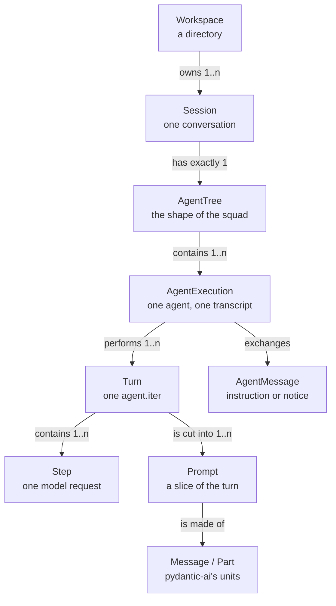

# The domain of Sigil

This page fixes the vocabulary. Every term here has one definition, one
identity, and a lifecycle; if a word is not here, it is not part of the domain
and the code should not invent it.

The rule is symmetric and unforgiving: **one concept, one word; one word, one
concept.** A word that names two things is a bug that survives review, because
both readings compile.

The glossary is not decoration. It decides what the tables are called, what the
API of the core exposes, and what a second client has to understand to speak to
it. Read it with [How Sigil stores its state](storage.md), which turns these
words into columns, and [How Sigil is layered](architecture.md), which turns
them into commands and events: a rename here is a rename in both.

## The lattice



Read it as a sentence: **a workspace has sessions; a session has a tree; the
tree has executions; an execution performs turns; a turn is made of steps, is
cut into prompts, and a prompt is made of messages.**

The nesting is strict, and every containment is a foreign key after the storage
change. That is why the words have to be right: they become columns.

## The five collisions that cost money

These are not style preferences. Each one is a place where two things share a
word, and the code today is ambiguous enough that a reader can be right and
wrong at the same time.

### 1. Turn, round and run

Three words for one thing, and no agreement on which is which. The codebase
already uses all three for the span **between the user sending a message and the
agent finishing**:

| Where | The word | What it names | Evidence |
| --- | --- | --- | --- |
| `start_turn`, `_turn_active`, `turn_handler` | turn | one `agent.iter()`, from submit to idle | `ui/turn_mixin.py:350` |
| `run_id` | run | the same `agent.iter()`, stamped by pydantic-ai | `context/strategy/rewriting.py:59` |
| `the round` | round | the same `agent.iter()`, in the context strategy's prose | `context/strategy/constants.py:49` |

And the same words also name the *parts*, which is worse:

| Where | The word | What it names | Evidence |
| --- | --- | --- | --- |
| `split_turns`, `TurnUsage`, `keep_recent_turns` | turn | a slice of history, cut at every user prompt | `context/strategy/turns.py:10` |
| `_scan`'s local `turn` | turn | the index of a prompt in the history | `context/images_cache.py:86` |
| `image_rounds` | round | a turn, counted by `run_id` | `context/strategy/constants.py:46` |

So "turn" is the whole *and* a part *and* an index, and "round" is both the
whole and, in one setting, something the setting next to it does not count.

#### The decision: one word, and it is Turn

**`Turn` is the only word in the domain.** `Round` is retired: it was a synonym
and nothing more. `Run` is retired from the domain as well, because it is the
library's vocabulary and because this codebase already uses "run" for four other
things that have nothing to do with a turn — `run_worker` (Textual), `runner.py`
(shell commands), `run_skill_script` (a bundled script), and `sigil.py:run()`
(the program). Importing that ambiguity into the domain would be trading one
collision for four.

A **Turn** is the span between the user sending a message and the agent
finishing. Steering belongs inside it: a steer is an extension or an alteration
of the prompt that opened the turn, and the code says so by construction —
`start_turn` with a turn already active defers to `steer`, and `steer` calls
`run.enqueue(...)` on the turn that is open (`ui/turn_mixin.py:236-254`). No new
turn starts.

`run_id` does not disappear; it gets **contained**. It is pydantic-ai's
identifier for the same span, it is 1:1 with a turn, and it is what the library
stamps on every message. So it lives in exactly one place — the adapter — under
a name that says it is foreign: `library_run_id`.

```python
class TurnOrigin(StrEnum):
    USER = 'user'  # a message the user sent
    WAKE = 'wake'  # the agent resuming itself to read answers nobody read
    INTERNAL = 'internal'  # a subtask the core starts (titling, compaction)


@dataclass(frozen=True, slots=True)
class Turn:
    id: str  # ours: 32 hex, the domain identity
    execution_id: str
    origin: TurnOrigin
    started_at: str
    finished_at: str | None  # None means the turn is open
    outcome: TurnOutcome | None  # None while open, then the result
    library_run_id: str | None  # pydantic-ai's run_id. Foreign, and private
```

`TurnOutcome` is `done`, `failed`, `cancelled` or `budget`. There is no
`running` value: **a turn is open or it is closed, and a closed one has an
outcome.** Two fields that can contradict each other are two bugs waiting; an
execution keeps a `running` status instead, because an execution resumes and a
turn never does.

**The rule that makes it a boundary rather than a rename:** no code outside the
adapter mentions `run_id`. `src/engine/agents/turn_map.py` is the only module
that knows the library's identifier exists, and it exposes two functions:

```python
def turns_of(messages: Sequence[ModelMessage]) -> list[Turn]: ...  # an imported log, into rows
def turn_id_of(message: ModelMessage) -> str | None: ...  # one message, to its turn
```

Everything else asks the domain. `grep -rn run_id src/engine
--exclude=turn_map.py` returning nothing is the test, and it is a cheap one to
run in review.

#### What the two settings were really counting

This is the part that makes the rename a bug fix and not a preference. Two
neighbouring settings both say "the last N", and they count different things:

| Setting | Today | Actually counts | Becomes |
| --- | --- | --- | --- |
| `keep_recent_turns = 3` | `split_turns` cuts at every user prompt | **prompts** | `keep_recent_prompts` |
| `image_rounds = 3` | `images_cache` groups by `run_id` | **turns** | `image_turns` |

Same sentence, two units, two words chosen so that each one means the wrong
thing in the other's file. A turn with three steers is one turn and four
prompts, so the two settings differ by a factor the user cannot see. Naming them
for what they count is the fix; the values do not change.

These names describe the historical rename. The append-only context policy has
since removed `keep_recent_prompts` and `SIGIL_CONTEXT_KEEP_RECENT_TURNS`; it no
longer drops whole prompts to fit a budget. An LLM checkpoint can replace an older
span only at a complete-exchange boundary, while the raw transcript stays intact.

`image_turns` still counts turns and is configured through
`SIGIL_CONTEXT_IMAGE_ROUNDS`. Reasoning retention counts individual blocks, and
tool retention counts individual calls, including parallel calls. Both counts
are independent settings. Image age is evaluated only at a compaction boundary;
the resulting omission is then replayed, not recomputed on every request.

See [context management](context.md) for the current settings and safety policy.

#### Turn, Prompt and Step

| Unit | What it is | Why it is separate |
| --- | --- | --- |
| **Turn** | the whole loop, one `agent.iter()`, one `library_run_id` | it is the unit of abort, of budget, of ownership and of "one thing the user asked for" |
| **Prompt** | a slice of a turn, cut where a user instruction arrives | it is the unit that can be dropped whole without orphaning a `ToolReturnPart`, which the provider rejects |
| **Step** | one model request and its response | it is the unit of cost and of the context meter |

One turn contains one or more prompts (steering) and one or more steps (tool
calls). Three units, three counts, no synonym.

### 2. Agent

Five meanings, one of them in a method that returns a different thing than its
name says.

| Meaning | What it is | Evidence |
| --- | --- | --- |
| `Agent` | pydantic-ai's object that holds model and tools | `agents/agent.py` |
| `AgentProfile` | The definition: name, prompt body, permissions | `profile/models/agent_profile.py` |
| `Session.agent` | A **profile name**, as a string | `sessions/session_store.py` |
| `AgentNode` | An **execution**: transcript, status, budget | `tree/models/agent_node.py` |
| `registry.agents()` | Returns `AgentProfile`s, not agents | `profile/registry.py:114` |

The codebase already says the right thing in prose — *"the id is the execution,
the name is the kind of agent"* (`tree/summoner.py:30`) — and the word
"execution" appears 22 times. It just was never made a type. `AgentNode` is
named after its position in a picture, not after what it holds.

**Canonical:** `AgentProfile` (definition), `AgentExecution` (durable unit of
work), `Agent` reserved for the library object. `Session.profile` replaces
`Session.agent`. `registry.profiles()`, `registry.root_profiles()`,
`registry.subagent_profiles()`.

### 3. Store

Ten classes, four jobs.

| Job | Examples | Should be |
| --- | --- | --- |
| Persistence | `SessionStore`, `FileAccountStore`, `FileSecretStore` | `-Store` |
| Live state that outlives a restart | `FileStateStore`, `RoadmapStore` | `-Store` **when it also persists** |
| The reference to what is in effect | `AgentTreeStore` | not a store at all |
| A registry of stores | `RoadmapStores` | `-Registry` |

`AgentTreeStore` is the clearest case: it holds "the tree of the session in
effect" and swaps it on `bind`. That is not storage, and once the core serves
several sessions it stops existing — a client asks for `session_id`, it does not
bind a global.

**Canonical:** `-Store` means *persistence of one aggregate, with a delta API*.
`-Registry` is lookup by name or id. `-Service` is orchestration across
aggregates. `-Hub` is fan-out of callbacks (already consistent: `QuestionHub`,
`ToolLoggerHub`).

### 4. Root

Seven things are called root, and they are not the same kind of thing.

| Term | What it is | Verdict |
| --- | --- | --- |
| `AgentTree.root_id`, `tree.root` | The execution the user talks to | **keep: `root` belongs to the tree** |
| `Workspace.root` | The directory of the workspace | `Workspace.path` |
| `Session.cwd` | The same directory, from the other side | `Workspace` (the FK) |
| `ScopeTracker.root` | The directory the instruction scope starts at | `Workspace.path` |
| `default_roots()` | Directories searched for profiles | `search_paths()` |
| `main_root`, `SessionStore.rebind_root` | Git's main worktree | `main_worktree`, `rebind(workspace)` |
| `output_reserve` | Room for the answer | not a root at all |

**Canonical:** `root` is the tree's, and nothing else's.

### 5. Tree

Two structures, one word.

| Where | Meaning | Evidence |
| --- | --- | --- |
| `agents/tree/` | The agents of a session | `AgentTree` |
| `context/instructions/` | The **filesystem** tree of directories | `workspace_file.py:11`, `constants.py:14` |

A reader of `context/instructions/workspace_instructions.py` reads "the resolved
tree" and has to work out that it is not the squad. **Canonical:** `AgentTree`
is the only tree; the filesystem one is `directory tree`, and the type is
`InstructionFile` (not `WorkspaceFile`, which sounds like a file *of* the
workspace when it is an `AGENTS.md` found in a directory).

## Three more, cheap to fix

| Word | The collision | Canonical |
| --- | --- | --- |
| `Selection` | The model choice (`domain/selection.py`) and the MCP servers a query touches (`mcp/manager/selection.py`) | `ModelChoice` / `ServerSelection` |
| `Capability` | The pydantic-ai hook (`AbstractCapability`), what a model can do (`ModelCapability`), and what a profile may call (`ToolPermissionsCapability`) | `Capability` is the library's hook only; `ModelSpec` for the facts |
| thinking / reasoning / effort | One concept, four words: the docs say *reasoning*, the UI says `/effort`, the library says `thinking=` | **reasoning** in the domain, `ReasoningLevel` for the value, `thinking=` only where the library demands the key |
| `block` | An `InstructionBlock` (text injected in the instructions), a `node_blocks` (per-execution instructions), and a widget (`AssistantBlock`) | `InstructionBlock`; engine says `execution_instructions`, never "block" |
| `task` | What a subagent was asked (`AgentExecution.task`) and a roadmap row (`TodoItem`) | `AgentExecution.brief` / `RoadmapItem` |
| `provider` alone | The configured account, the upstream vendor, and an MCP server | always: `account`, `vendor`, `server` |

## The glossary

Identity is what the type is keyed by; lifecycle is what can happen to it. Both
become columns.

### Workspace

The directory a session is bound to. Identity: its real path. A workspace *may*
be a git worktree — every worktree is a workspace, but a directory outside git
is a workspace with no worktree. It is where the file tools read and write,
where `AGENTS.md` is looked up, and how `/load` groups sessions.

Lifecycle: it appears the first time Sigil opens it and never disappears; a
workspace with no sessions is not shown.

### Session

One conversation, and everything needed to resume it: the transcript, the tree,
the profile and the model it ran on, its title. Identity: `id` (32 hex chars).
It is the **aggregate root**: nothing outside it is addressed without it.

Lifecycle: created empty, grows with turns, resumed with `/load`, named once by
the title request. It is not deleted by any code path today.

`title` is the generated one; `preview` is the first prompt; `display_title` is
`title or shorten(preview)`. Three names for three things, kept because the
sidebar needs all three.

### AgentProfile

The definition of an agent: name, Markdown body, permissions, role, channel.
Identity: `name`, resolved through three sources (`builtin`, `project`,
`global`) with project shadowing global shadowing builtin. It has **no state**:
two sessions using `wizard` share one profile.

`ProfileRole` is `agent` (may be the session's) or `subagent` (only summonable).
It is a property of the definition, not of an execution.

### AgentExecution

One concrete use of a profile inside a session: a transcript, a status, a
budget, a task. Identity: `id` (32 hex chars). It is what `summon` returns and
what the tree addresses.

- The **root execution** is the one with no parent, and it is the only one whose
  profile is the session's.
- A **subagent** is an execution whose parent is not `None`. It is a role, not a
  type: nothing about the object changes.
- It **resumes**: a second call with its id continues its transcript instead of
  starting over. That is why it is durable while a turn is not.

Lifecycle: `running` → `done` | `failed` | `cancelled`, and `running` again when
resumed. It carries `turns` as a counter, which is the number of turns it has
performed. It is `turns` and not `runs` because the domain has no `Run`: the
library calls the span a run, and the schema keeps that word in
`library_run_id`, on `turns`.

Today this type is `AgentNode`, and the root's transcript lives on the session
while every other execution's lives on the node. That asymmetry is the modelling
bug the storage change fixes: `messages` is keyed by execution, and the root is
an execution.

### AgentTree

The structure over the executions of one session: one root, nesting by parent,
depth-first order. It is not storage and it is not a second source of truth; it
is the shape, derived from `parent_id` and `started_at`.

### Turn

The span between the user sending a message and the agent finishing: one
`agent.iter()` from start to idle. Identity: `id`, 32 hex characters, ours. It
belongs to an execution, and it is what the user calls a turn.

It is **the unit of five things**, which is why confusing it with a prompt
matters:

- identity of the work: everything the agent does between two idle moments;
- abort: cancelling a turn stops its steps;
- budget: `max_steps` is counted per turn;
- pricing windows: reasoning and images are kept or dropped per turn;
- ownership: once the core is a service, one client asks for a turn and one
  writes it.

It carries an **origin** — `user`, `wake` or `internal` — because a turn the
agent started for itself is the same unit of work and a different kind of event.
Only a turn of the root execution with `origin = 'user'` is a **rollback
point**; see [rollback](rollback.md) for why a steer and a subagent's turn are
not. A wake happens when a subagent answers and no turn is open: the app starts
one with `WAKE_PROMPT` (`ui/tree_mixin.py:48`), and by the definition above it
is a turn nobody typed. That distinction decides who owns it once the core is a
service: a wake belongs to no client.

A turn contains one or more prompts, because steering injects a prompt into the
running loop instead of starting a new one. It also contains one or more steps,
because a turn that calls a tool asks the model more than once.

**Not a domain type:** `Run`. pydantic-ai calls the same span a run and stamps
its `run_id` on every message it produces. The mapping is 1:1 and it lives in
`agents/turn_map.py`; the field is `library_run_id`, and nothing outside that
module names it.

### Checkpoint

An instant a session can be returned to: the turn it marks, the workspace as it
was, and the plan as it was. Identity: `id`, which is also the name of the git
ref that holds the tree. It is written when a turn starts, and it has a `reason`
— `prompt`, `before_rollback` or `manual` — because the three are not the same
kind of thing.

A `prompt` checkpoint is a place the user can go back to. A `before_rollback`
checkpoint is the undo of a rollback, and it is the reason nothing is ever lost
destructively.

### Rollback

Returning a session to the instant before a turn started: the conversation, the
plan and the workspace, in one operation. It is a command of the core
(`rollback_to`), never something a client does by hand, and it is described in
[rollback](rollback.md).

### Step

One model request and its response: one call to the provider. `StepBudget`
counts them. It is the unit of cost and of the context meter, because it is
exactly what a request costs.

### Prompt

A slice of a **turn**, starting at a message that carries a user instruction and
ending before the next one. It exists so a slice can be dropped whole without
leaving a `ToolReturnPart` without its call, which is a 400 from the provider.

Three things reach a turn as a prompt:

- what the user types, which opens the turn;
- what the user types **while the agent is working**: a steer, which extends the
  turn instead of opening a second one;
- what another execution sends as an `AgentMessage` of kind `instruction`.

So the count of prompts is not the count of turns, and a window measured in
prompts is not a window measured in turns. Both are legitimate; they are not the
same number, and after this change each one has its own name.

### Message and Part

`ModelRequest` and `ModelResponse`, made of parts, all of them pydantic-ai's.
Their shape is the library's and the domain does not rename it: it is stored as
the library writes it, and read back by the library's own validator.

### AgentMessage

A message between two executions: `instruction` (parent to child, something to
do) or `notice` (child to parent or sibling, something to know). Identity: `id`.
Parent-to-child instructions enter the child's history as live-run steering.
Child-to-parent and sibling notices are stored in the session's notification
log and shown in one dynamic table for the receiving execution. Both paths
require a live receiver. Final asynchronous reports use a separate delivery
mechanism and can wait for the next turn.

A notification has a stable session-scoped ID and sequence. Its ACK means
"OK, received," not read, agreed, acted on, or resolved. Only its receiver can
ACK it. ACK never removes content or changes position: pending and ACK rows
remain together in sequence order, including after a session reload.

### RoadmapItem

A task in one execution's plan. Identity: `id` (8 hex chars), scoped by session
and execution. Status: `pending`, `in_progress`, `done`, `blocked`.

The plan belongs to the execution that is executing it: the root's plan and a
subagent's plan answer different questions and are different lists.

### ModelAccount, ModelChoice, ModelSpec

Three layers that are usually all called "provider":

- **ModelAccount**: the configured thing, with an alias and credentials.
  Identity: `id`. Uniqueness: `alias`, case-insensitive.
- **ModelChoice**: what a session runs on — account, model, reasoning level,
  window, efforts, images. It travels with the session so a resume does not
  silently change cost.
- **ModelSpec**: what the catalogue says a model can do (window, images, effort
  levels). It comes from the network and degrades to "unknown", never to a
  guess.

The vendor behind the account (Anthropic, OpenAI, OpenRouter) is a `vendor`, and
an MCP server is a `server`. Neither is ever called "the provider" alone.

### Skill, LoadedSkills

A `Skill` is a definition on disk. **`LoadedSkills` is the set loaded by one
execution, in load order, and it is a projection of that execution's transcript,
not a stored object** — see [derived
state](#derived-state-what-is-projected-not-stored). It is recovered from the
`load_skill` calls the log already contains.

The body of a loaded skill travels as an instruction block, not as a tool
result, which is what makes it survive compaction and keeps it out of the
history budget; it is also why the set is per execution and not per session.

### Tool, Toolset, Capability

A **tool** is one callable the model can see. A **toolset** is a group of them
that arrives together (an MCP server contributes one). A **Capability** is a
pydantic-ai hook that runs around the loop — the context projection, the step
budget, the feature gate, the permission gate, the retry. A capability is not a
feature the model has, and a `ModelSpec` is not a capability.

## Derived state: what is projected, not stored

Some of what a session knows is **not** stored as a column, because it can be
recomputed from the log exactly: the loaded skills, and the prompt a message
belongs to.

The rule: **if the log can answer it, the log is the answer.** A second copy is
a second thing to keep in step, and the failure mode is silent — the copy is
right until the day it is not, and nothing tells you which one to believe.

### Loaded skills, the worked example

A `load_skill` call is a `ToolCallPart` in the execution's transcript, with the
name in its arguments, answered by a `ToolReturnPart` carrying the same
`tool_call_id`. That is the whole record, and one walk of the log recovers it in
load order:

```python
def loaded_skills(messages: Sequence[ModelMessage]) -> tuple[str, ...]:
    """The skills an execution loaded, in order, from its own transcript."""
```

Three properties make it exact rather than approximate:

- **Per execution, not per session.** A subagent's loads are its own; a shared
  set would put one agent's guidance into another's prompt.
- **The log, not the view.** The view is a projection that drops old prompts;
  the log keeps every call. `load_skill` results are pinned (`PINNED_TOOLS`), so
  the call stays even in the view — but the log is the thing that cannot lose
  it.
- **A failed load does not count, and the filter is `outcome`, not the part
  kind.** This one is a trap worth writing down: `ToolErrorRecovery` turns a
  tool exception into a `ToolReturnPart` with `outcome='failed'`
  (`agents/tool_errors.py`), so a failed `load_skill` — an unknown name, an
  unreadable `SKILL.md` — **looks successful** to anyone who only checks that a
  return part exists. The filter is `outcome == 'success'`, and it works on the
  stored payload too: a `tool-return` part carries `"outcome": "success"` next
  to its `tool_call_id`.

Deriving is also **fast enough not to argue about**: 0.17 ms over an 857-message
log, measured. There is no cache to invalidate because there is nothing to keep.

### What it buys

Two operations become correct for free, and both are broken when the set is kept
on the side:

| Operation | With a stored copy | As a projection |
| --- | --- | --- |
| Resume a session | The copy is not in the file (today's bug), so the agent silently loses the skills it was told to follow | The log is the file: the set comes back with it |
| Roll back to a turn | The copy must be rewound by hand, and a forgotten rewind leaves a skill in effect that the conversation no longer mentions | Truncating the log truncates the set |

### Where the copies already are, and what they cost

Today the set lives in `SkillLoads`, in memory, and `SkillLoads.to_dict()` /
`restore()` exist and are tested — but the session store never calls them. The
consequence is measurable in a real session of this install: after a restart,
the instructions of the same session dropped from 73,892 to 29,476 characters.
The agent kept working, having silently stopped following four skills, and
nothing in the UI said so.

That is what a second copy drifting looks like: no error, no exception, a
behaviour change nobody can see.

## Command and Event

The core is spoken to in two words, and they are not interchangeable.

A **Command** asks for something to happen and answers once: with a value, or
with a typed error. It is the only way to change anything. `start_turn`,
`steer`, `abort`, `summon`, `set_model`, `rollback_to` are commands.
**`rollback_to` is the only one that destroys state**, which is why it is also
the only one required to leave a recoverable copy behind.

An **Event** states that something happened and answers nobody. It carries ids
and a delta, never the state itself, because the state lives in the database and
a second copy on the wire would eventually disagree with it. `turn_started`,
`text_delta`, `execution_changed`, `answer_waiting` are events.

The rule that keeps the pair honest: **a command may cause events; an event
never causes a command.** A client that reacts to an event by calling a command
is choosing to, and that choice is visible in the client, where it belongs.

### Every command has an owner

The palette a user types into is one list, but a command is not one kind of
thing. `/new` creates a session; `/theme` repaints this window. A second client
must be able to do the first and cannot possibly do the second, so each command
declares who serves it:

| Owner | What it means | Examples |
| --- | --- | --- |
| `core` | the domain owns the state and the answer; a client formats it | `/new`, `/load`, `/agent`, `/provider`, `/model`, `/effort`, `/mcp`, `/context`, `/rollback` |
| `client` | only the client in front of the user can: it configures or paints itself | `/theme`, `/sidebar`, `/reasoning-visibility`, `/debug`, `/help`, `/quit` |

The test is the same one that draws the layer boundary: **if it decides, it is
core; if it shows, it is client.** `/effort` looks like a setting and is a core
command, because it changes the reasoning level a turn runs with and the choice
travels in the session; `/debug` shows domain state but is a client command,
because the widget, its timer and its layout belong to whoever is drawing.
`/tools` is the same shape as `/reasoning-visibility`: the tool results are in
the transcript either way — that is the domain's — and whether they are printed
in full is how this window reads them.

The three of them live in `PreferencesMixin` (`ui.json`), which is *the client's
preference surface* and not a theme feature: the name says which side of the
boundary it is on.

The catalogue lives in `engine/commands.py` because it is shared vocabulary and
carries no widget. A client reads it, keeps every command, and knows which ones
it delegates — and the ones it does not delegate are its own to replace.

## Suffixes

The suffix says what kind of thing it is, and a type that does not fit gets
renamed rather than given a new suffix.

| Suffix | Means | Example |
| --- | --- | --- |
| `-Profile` | A definition, no state | `AgentProfile` |
| `-Execution` | A durable unit of work with a transcript | `AgentExecution` |
| `-Store` | Persistence of one aggregate, with a delta API | `SessionStore` |
| `-Registry` | Lookup of definitions by name or id | `AgentRegistry` |
| `-Service` | Orchestration across aggregates | `SessionService`, `TurnService`, `TreeService` |
| `Core` | The composition of the services and the event stream: the single entry point | `SigilCore` |
| `-Hub` | Fan-out, registration and replay of what happened | `QuestionHub`, `EventHub` |
| `-Map` | Translation to or from a foreign vocabulary | `turn_map` |
| `-Summary` | A projection for listing, no transcript | `SessionSummary` |
| `-Snapshot` | A value copied at one instant | `ContextSnapshot` |
| `-Sink` | A callable that consumes events | `ScopeSink` |
| `-Spec` | A structural description of facts | `ModelSpec` |

Three domain nouns carry no suffix, because they are the vocabulary itself and a
suffix would make them sound like an implementation detail: `Workspace`,
`Session`, `Turn`. An `Agent`, `AgentProfile` and `AgentExecution` keep theirs
because the three of them would otherwise be one word.

Never: `-Manager` for something that only orchestrates a switch
(`WorkspaceManager` is the last one, and it becomes `WorkspaceService` when the
core exists), `-Store` for live state, `-Helper`, `-Util`, `-Data`.

## What changes, and when

The rename is not cosmetic churn: it is cheapest **before anything is written**,
because a database that already holds sessions cannot be renamed without a
schema step over real rows. Since the database starts empty, the name a thing
gets now is the name it keeps.

### Free, no data involved

| Old | New | Risk |
| --- | --- | --- |
| `AgentNode` | `AgentExecution` | Type only; touches 12 modules |
| `AgentTree.nodes()` | `executions()` | The view keeps "node" as a row on screen |
| `registry.agents()` | `registry.root_profiles()` | Returns profiles; the name lied |
| `registry.subagents()` | `registry.subagent_profiles()` | Same |
| `ModelCapability` | `ModelSpec` | Type only |
| `Selection` | `ModelChoice` | Type only; MCP's becomes `ServerSelection` |
| `split_turns` | `split_prompts` | Function only. It cuts prompts, not turns |
| `keep_recent_turns` | `keep_recent_prompts` (historical) | Both the field and `SIGIL_CONTEXT_KEEP_RECENT_TURNS` were later removed with prompt dropping; see [context management](context.md) |
| `TurnUsage`, `TurnSummary` | `PromptUsage`, `PromptSummary` | Types only: the meter measures prompts. The freed name `TurnUsage` is then the real per-turn cost |
| `image_rounds`, `DEFAULT_IMAGE_ROUNDS`, `current_round`, `round_index` | `image_turns`, `DEFAULT_IMAGE_TURNS`, `current_turn`, `turn_index` | It always counted turns; `SIGIL_CONTEXT_IMAGE_ROUNDS` keeps its name and is mapped |
| `the round` in the context strategy's prose | `the turn` | `strategy/constants.py`, `rewriting.py`, `images_cache.py` |
| `_scan`'s local `turn` (the prompt index) | `prompt_index` | Local only; it is what it counts |
| `run_id` on a message we read | `turn_id` from the column, or `turn_map.turn_id_of()` | Never named outside the adapter |
| `start_turn`, `_turn_active`, `turn_handler` | **unchanged** | They were already right. They move into `TurnService` with the core |
| `SkillLoads` (a registry per node) | `loaded_skills(execution_id)`, a projection | The type stops existing; `for_node`, `reset`, `to_dict` and `restore` go with it |
| `node_blocks` | `execution_instructions` | Kwarg |
| `WorkspaceFile` | `InstructionFile` | Type only |
| `AgentTreeStore` | `Binding`, or removed by the core | Type only |
| `RoadmapStores` | `RoadmapRegistry` | Type only |

### Serialized today, so it moves with the data change

| Old key | New | Where |
| --- | --- | --- |
| `session['agent']` | `agent_executions.profile` of the root | JSON and column. Not on `sessions`: the profile belongs to the execution that runs it |
| `node['name']` | `agent_executions.profile` | JSON and column |
| `node['task']` | `agent_executions.brief` | JSON and column |
| `node['role']` | `agent_executions.role` | Unchanged in meaning |
| `session['cwd']` | `sessions.workspace_id` | JSON path to FK |
| `session['messages']` | `messages` rows of the **root execution** | The asymmetry goes away: `Session.messages` becomes a projection of the root |
| `tree.nodes` | `agent_executions` rows | Structure becomes rows |
| `run_id` inside each message payload | `turns` rows, linked by `messages.turn_id` | The library's boundary becomes a domain row; the payload stays untouched inside `payload` |

### Never

- `Session` and `Workspace`: they are the words the user sees, and they are
  right.
- `run_id` **inside the adapter**: it is pydantic-ai's, and fighting the library
  is worse than containing it. Everywhere else the field is `library_run_id` and
  the domain word is `turn`.
- Tool names the model sees (`update_roadmap`, `summon`, `read_file`, …): they
  are an API contract with a model that will still be reading old transcripts.
- `ModelRequest`, `ModelResponse`, `ModelMessage`, `ToolCallPart`,
  `AbstractCapability`: the library's vocabulary, used as it is.

## Invariants worth writing down

1. **One root per session, and a session always has one.** Two roots, or none,
   is a corrupt session. Both halves are constraints of the database, not
   conventions: a unique index refuses the second and a trigger refuses to
   delete the last (see [storage](storage.md)).
2. **A root's profile is the session's profile.** `/agent` renames the root; it
   does not create a new execution.
3. **A child cannot outlive its parent.** Ending an execution stops what is
   under it.
4. **A notice travels through the sender's channel policy**, and a notice is
   information, not an order.
5. **A turn is owned by one execution, and at most one turn of an execution is
   open at a time.** Reads may be many; the writes of a turn come from whoever
   started it. The summoner's channel policy already guarantees it — a message
   to a running execution is delivered into its turn, never as a second one —
   and the database enforces it with a partial unique index (see
   [storage](storage.md)).
6. **A session is resumable from its stored state and transcripts.** No live
   object is required. Notification content and ACK state are persisted data,
   not facts inferred from an ACK tool call.
7. **A prompt never ends mid tool call.** That is why a prompt, and not a
   message, is the unit that can be dropped.
8. **Derived state is computed, never kept.** The loaded skills and the prompt a
   message belongs to are read from the log. A copy is allowed only as a cache
   with an invalidation rule, never as a second source of truth.
9. **Nothing is destroyed without a recoverable copy.** A rollback exports the
   tail it is about to drop and snapshots the tree it is about to overwrite,
   before it touches either. Undoing a rollback is one command pointed at the
   `before_rollback` checkpoint.

## The two decisions, settled

They were open because they change behaviour, not just names. Both are decided,
and both are cheap only because the storage change has not happened yet.

1. **The root's transcript moves under the root execution, now.**
   `Session.messages` becomes a projection of the root execution: reading a
   session is reading an execution. A session is created together with its root
   execution in one transaction, so there is never a session without one and the
   invariant becomes a constraint instead of a wish. It is not a migration: the
   database starts empty, so the root execution exists from the first session
   the new build ever writes, and there is no older shape to convert.
2. **`Turn` is the only word, and it is both the user's word and the system's.**
   It was tempting to keep `Run` for the system and `Turn` for the user, and it
   was wrong: two words for one concept is the collision this document exists to
   remove, and `run` is already four other things in this codebase. `Round` is
   retired, `Run` is contained in `turn_map.py` as `library_run_id`.

### What settles with them

- `roadmap_items` no longer needs the `''` sentinel for "the root's plan": the
  root has an id, so every plan is keyed by a real execution.
- `sessions` no longer needs a `profile` column: the root execution holds it and
  the list query joins. One fact, one place.
- A partial unique index enforces **one root per session**, so invariant 1 is
  something the database refuses to violate.
- A **turn becomes a row**, not a boundary the code infers from `run_id` inside
  message payloads. That is what makes the domain visible in the data: cost per
  turn is an aggregate, "the last three turns" is a bounded query instead of a
  scan whose target is unknown until parsed, and the wake is a row with `origin
  = 'wake'` instead of a synthetic prompt nobody can find later.
