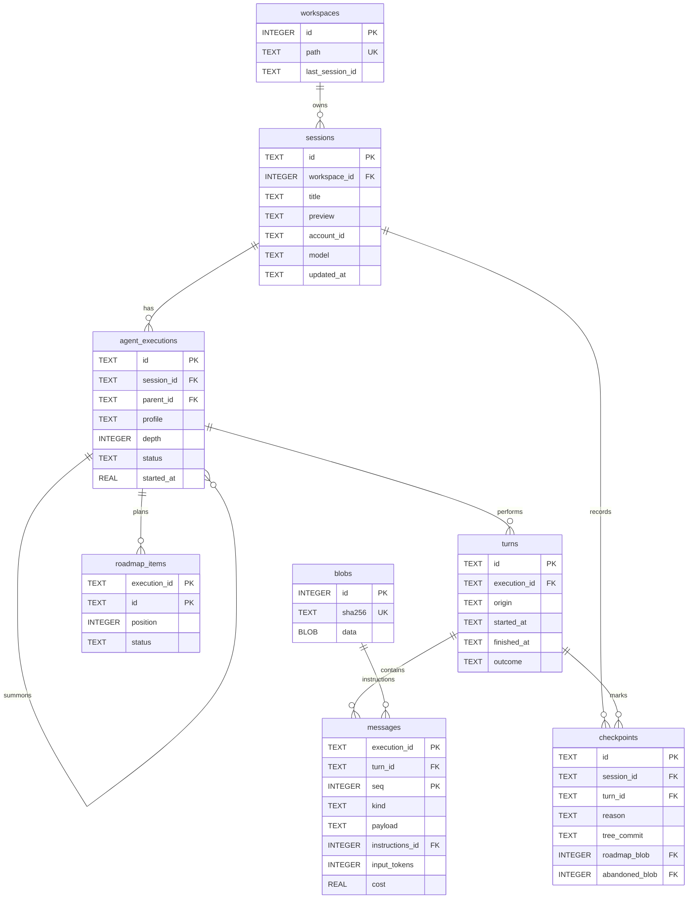
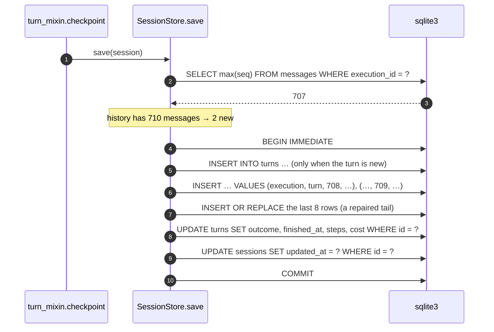

# How Sigil stores its state

This page describes where Sigil keeps what it knows, what the JSON files cost
before, and the SQLite schema that replaced them. Read it before changing the
session store, the roadmap, or anything that writes under `~/.sigil`.

The names in the schema come from [the domain](domain.md): a session owns a tree
of executions, an execution produces messages, and the whole change is one
translation of that lattice into tables.

The short version: **the data moves to one SQLite database; the configuration
stays JSON.** The reason is not taste. A checkpoint rewrites the whole session,
so a turn pays for the entire history once per second, and a long turn spends
more and more of its time re-writing what it already wrote. That is the
slowness.

<!-- prettier-ignore -->
> [!IMPORTANT]
> **Implemented.** Sessions, their agents, their turns, their plans, the
> provider accounts and the preferences are rows; the file store is gone. The
> numbers in "What it cost before" are the *before*, measured on the JSON
> files; the ones at the end of the page are the *after*, measured on the
> implementation.
>
> What is still a file, on purpose: the credentials (a `0600` file, because
> secrets do not share permissions with data that must be world-readable) and
> the configuration (themes, MCP, agent profiles).

## Agent notifications

Intermediate child-to-parent and sibling notices are session state, separate
from conversation messages. `agent_notifications` stores the sender and
receiver execution IDs, full content, creation time, session sequence, and ACK
state. Schema version 3 adds this table and its receiver index to existing
version 2 databases without changing their history.

Each receiver gets one dynamic notification table on every model request,
ordered by sequence. IDs such as `n-7` are scoped to the session. ACK changes
only the state: it does not read, resolve, reorder, or remove a notification.
Acknowledged rows remain visible alongside pending rows for the lifetime of
the session; there is no automatic pruning in this implementation.

The tree owns the in-memory log. Session saves persist it in the same
transaction as executions and transcripts. Rendering never changes ACK state;
`ack_notifications` validates the entire batch against the caller's execution
before updating it. Repeating an ACK is idempotent, including in memory.
Checkpoint writes compare the stored log with the snapshot: they insert only
new notifications and update only new ACKs. An unchanged checkpoint issues no
notification writes. ACK is monotonic: a stale snapshot cannot revoke a stored
ACK. A conflicting ID with different content or sender is rejected before any
notification writes instead of silently losing the new content. This comparison
still reads the session's notification log; it is not a constant-time save.

The domain rejects invalid fields and duplicate sequences. Restoring malformed
records raises a contextual error instead of silently dropping notices.
Notifications are included in session exports and deleted with their session
or participating execution.
A fork starts a separate notification log rather than copying the current
session's inbox; notification ACK state is not a turn-level rollback snapshot.

Parent-to-child instructions bypass this table and enter the child's history
through live-run steering. Final asynchronous reports keep their existing
report-delivery mechanism. Both intermediate paths still require a live
receiver; an ACK does not start or resume a turn.

## What it cost before

Every number here was measured on this install (`~/.sigil`: 51 session files, 50
distinct sessions, 14 workspaces, 14,382 messages, 396 MB of JSON) with the tree
at the time of writing. The absolute values depend on the machine; the shape
does not.

A turn checkpoints once per second and once per stream event
(`CHECKPOINT_INTERVAL` in `src/ui/turn_mixin.py`), and each checkpoint
re-serializes the entire session and rewrites the file:

| History | File on disk | One checkpoint | Blocked loop per 60 s turn |
| --- | --- | --- | --- |
| 100 messages | 5.6 MB | 26 ms | 1.5 s |
| 400 messages | 22 MB | 115 ms | 6.9 s |
| 700 messages | 39 MB | 211 ms | 12.7 s |
| 1400 messages | 61 MB | 332 ms | 19.9 s |

The loop is the UI's loop. A checkpoint does not run in a thread, so those
milliseconds are frames the window does not draw. At 1400 messages the app is
frozen for a third of every second while the agent works, and the freeze grows
with the conversation — which is exactly the "it gets slower" the user feels.

The other file operations have the same cause:

| Operation | Today | After |
| --- | --- | --- |
| List one workspace (`list_sessions`) | 1,495 ms | 0.01 ms |
| Load a 61 MB transcript | 132 ms | 36 ms |
| Read a roadmap | file read per session and per execution | 0.01 ms |
| Cost and cache totals for `/context` | parse the whole history | 0.16 ms |

`/load` is the worst one, and it is worse than it looks: `catalog()` builds a
`SessionStore` per workspace and calls `list_sessions()`, which **parses every
transcript in every workspace** — 396 MB of JSON — only to paint a list of
titles. The picker needs an id, a title, a timestamp, and a short id.

## Where the bytes go

Before choosing a schema, it is worth knowing what the 396 MB are made of. For
one 61 MB session with 1,400 messages:

| Part | Share of the file |
| --- | --- |
| `instructions` — the same ~23 KB block, repeated on every request | 91.2% |
| `thinking` parts | 2.4% |
| `tool-return` parts | 2.3% |
| `tool-call` parts | 1.7% |
| Everything else (text, timestamps, run ids, metadata) | ~2.4% |

Across all 51 files, **327.9 MB of the 385.6 MB of JSON content are
`instructions`, and there are only 64 distinct blocks in the whole install,
totalling 3.12 MB.** The same block, written again on every message, in every
session.

pydantic-ai stores the instructions on each `ModelRequest` on purpose — a
history is self-contained, and a request is reproducible even if the instruction
function changes. Sigil does not have to pay for that on disk. It only needs the
text back when the history is read.

## The decision

| Data | Where it lives now | Where it goes | Why |
| --- | --- | --- | --- |
| Session metadata (title, preview, model, timestamps) | `sessions/<hash>/<id>.json` | `sessions` table | The picker needs it without the transcript |
| Message history, root and subagents | same file, `messages` and `tree.nodes[].messages` | `messages` table, keyed by execution and turn | Append one row, not rewrite the file; and the root stops being a special case |
| The turn each message belongs to | implicit, inside each payload as `run_id` | `turns` table plus `messages.turn_id` | The domain unit becomes a row: cost per turn is an aggregate and "the last N turns" is a bounded read |
| The workspace as it was at a message, for rollback | nothing | `checkpoints` table, with a git commit and the plan in a blob | Rollback is designed now and built later; see [rollback](rollback.md) |
| Repeated instructions blocks | inline, once per request | `blobs` table, content-addressed | 327.9 MB become 3.12 MB |
| Images and other binary content | base64 inside the JSON | `blobs` table, raw bytes | Base64 costs 33% more than the pixels |
| Per-workspace "last session" | `index.json` | `workspaces.last_session_id` | One row instead of a file per workspace |
| Agent tree, **including the root** | `tree` inside the session file, and `messages` outside it | `agent_executions` table | A subagent's transcript is the same shape as the root's, so the root becomes a row like any other |
| Roadmaps | `roadmaps/<hash>/<session>--<node>.json` | `roadmap_items` table, keyed by execution | Update one task instead of rewriting the list |
| Provider accounts, UI state | `providers/accounts.json`, `providers/state.json` | `accounts`, `app_state` tables | It is data, and the database will already be there |
| Credentials | `providers/credentials.json` (0600) | **stays a file** | Secrets do not share a file with data that must be world-readable |
| Themes, `ui.json`, MCP config, agent profiles, `.env` | JSON, YAML, Markdown | **stays as files** | Configuration: hand-edited, diffed, shared through dotfiles |
| Worktrees created by `/new --worktree` | `worktrees/<repo>/<name>` | **stays on disk** | They are git checkouts, not state |

The line is simple: **if Sigil writes it while you work, it is data; if you
write it while configuring Sigil, it is configuration.** Configuration stays in
files because a person edits it and a repository can diff it. Data moves because
a program writes it thousands of times and reads it in slices.

## The data model

One database, `$SIGIL_HOME/sigil.db`, for every workspace. Worktrees are the
reason: a session belongs to a directory, and `/load` lists the sessions of
every worktree of the repository. With one database that is a join; with one
database per workspace it is a loop over connections.



### `workspaces`

One row per directory Sigil has been opened in. It replaces the `cwd-hash`
folder name and the `index.json` inside it.

| Column | Type | Notes |
| --- | --- | --- |
| `id` | `INTEGER PRIMARY KEY` | Surrogate, so `sessions.workspace_id` is 4 bytes instead of 64 |
| `path` | `TEXT NOT NULL UNIQUE` | The real path, `os.path.realpath` of the workspace |
| `last_session_id` | `TEXT` | What `index.json` held. Deliberately **not** a foreign key: it is a hint, and a hint that points at a deleted session must degrade to "the newest one" instead of blocking a delete |
| `updated_at` | `TEXT NOT NULL` | ISO 8601 UTC, the same strings the app already uses |

The hash goes away as an identifier and stays only as a directory name in the
old layout. Storing `path` lets the picker label a session with its worktree
without shelling out to `git` for each one.

### `sessions`

The row the picker reads. It holds no message text.

| Column | Type | Notes |
| --- | --- | --- |
| `id` | `TEXT PRIMARY KEY` | `uuid4().hex`, 32 hex characters, `WITHOUT ROWID` |
| `workspace_id` | `INTEGER NOT NULL` | `REFERENCES workspaces(id) ON DELETE CASCADE` |
| `title` | `TEXT` | The generated title, or `NULL` |
| `preview` | `TEXT NOT NULL DEFAULT ''` | First user message, computed once at the first save |
| `account_id`, `model`, `thinking`, `window`, `efforts`, `images` | | The `ModelChoice` flattened. `efforts` is a JSON array; a row per effort level would be overdrawn |
| `created_at`, `updated_at` | `TEXT NOT NULL` | ISO 8601 UTC |

There is **no `profile` column**. The profile belongs to the execution that runs
it, and the session's profile is its root's — so the list query joins on
`parent_id IS NULL`, which the one-root index serves. One fact, one place: a
column here would need a trigger or a promise to stay equal to the root's, and
both fail eventually.

`preview` is the column that makes `/load` cheap, and it is worth being explicit
about the trade: it duplicates text that is also in the first message. Today
`Session.display_title` computes it by walking the history, which is fine when
the history is in memory and disastrous when reading it costs a parse of 61 MB.

`ModelChoice` is flattened into columns instead of stored as one JSON blob
because `account_id` and `model` are the fields a future query would filter by,
and the rest are cheap scalars. A JSON column would also work; the flattened
form needs no `json_extract` and no schema change to add an index later.

### `agent_executions`

The tree, one row per execution. **The root is an execution too**, and that is
the whole point of the table: the root's messages used to live in
`Session.messages` and a subagent's in `AgentNode.messages`, so every reader of
a transcript handles two shapes and every writer has two code paths. See [the
domain](domain.md) for why this table is not called `agent_nodes`.

A session is created together with its root execution, in one transaction. There
is therefore no session without a root, `sessions` carries no profile of its
own, and "one root per session" is not a convention but two constraints: one
unique index that refuses a second root, and one trigger that refuses to leave a
session without one.

```sql
CREATE UNIQUE INDEX executions_one_root
    ON agent_executions(session_id) WHERE parent_id IS NULL;

CREATE TRIGGER executions_no_orphan BEFORE DELETE ON agent_executions
    WHEN OLD.parent_id IS NULL
     AND EXISTS (SELECT 1 FROM sessions WHERE id = OLD.session_id)
    BEGIN SELECT RAISE(ABORT, 'delete the session, not its root'); END;
```

The `EXISTS` is not decoration. SQLite fires this trigger for a delete cascaded
from `sessions` too, so an unconditional guard would make deleting a session
impossible — the opposite of what the guard is for. By the time the cascade
reaches the execution, the session row is already gone, the condition is false,
and the delete goes through. Both halves were tested: a direct `DELETE FROM
agent_executions` aborts, and `DELETE FROM sessions` removes the tree cleanly.

Consequences worth stating, because they simplify the rest of the schema:

- `Session.messages` becomes a projection: reading a session is reading its root
  execution. Nothing else in the store knows about the asymmetry.
- `roadmap_items` no longer needs a sentinel for "the root's plan": the root has
  an id, so every plan is keyed by a real execution and the column can be a
  foreign key.
- The profile of the session is the profile of its root, so `/agent` is one
  `UPDATE` of one row and there is no second copy to keep in sync.

| Column | Type | Notes |
| --- | --- | --- |
| `id` | `TEXT PRIMARY KEY` | `uuid4().hex` |
| — | | No `session_id`: it is derivable from the execution, and the session cascade already reaches the rows through it |
| `parent_id` | `TEXT` | Self reference, `ON DELETE CASCADE`. `NULL` only for the root |
| `name`, `role`, `depth` | | `role` is `agent` or `subagent`; `depth` is derived but stored because the tree view sorts by it |
| `brief`, `status`, `mode`, `model` | | What the execution was asked to do and how its parent waits |
| `result`, `error` | `TEXT` | The answer, and why it failed |
| `started_at`, `finished_at` | `REAL`, `REAL` | Epoch seconds, as today: elapsed time is what the view paints and a number needs no parsing |
| `turns`, `delivered`, `channel`, `max_steps`, `budget_exhausted` | | Lifecycle flags the tree view reads. `turns` is how many turns the execution has performed: an execution resumes, so it returns to running more than once |

`channel` is the profile's policy serialized as JSON, because it is a
declaration that is read whole and never queried by part.

### `turns`

One row per turn: the span between the user sending a message and the agent
finishing, which is the unit the domain calls a `Turn` (see [the
domain](domain.md)). Until now this boundary existed only inside each message
payload, as pydantic-ai's `run_id`, so reading it meant parsing the transcript.

| Column | Type | Notes |
| --- | --- | --- |
| `id` | `TEXT PRIMARY KEY` | Ours, 32 hex characters. `WITHOUT ROWID` |
| `execution_id` | `TEXT NOT NULL` | `REFERENCES agent_executions(id) ON DELETE CASCADE` |
| `origin` | `TEXT NOT NULL` | `user`, `wake` or `internal`. A wake is the turn the agent starts to read answers nobody read, and it belongs to no client |
| `started_at` | `TEXT NOT NULL` | ISO 8601 UTC |
| `finished_at` | `TEXT` | ISO 8601 UTC. **`NULL` means the turn is open**, and that is the only thing that means it |
| `outcome` | `TEXT` | `NULL` while the turn is open, then `done`, `failed`, `cancelled` or `budget` |
| `steps` | `INTEGER NOT NULL DEFAULT 0` | Model requests in this turn. Updated at the end |
| `cost` | `REAL` | What the provider reported, summed. `NULL` when it reported nothing |
| `library_run_id` | `TEXT` | pydantic-ai's `run_id`, which is 1:1 with a turn. **Foreign vocabulary**, kept here and nowhere else, so the adapter can map a message to its turn |

```sql
CREATE INDEX turns_by_execution ON turns(execution_id, started_at);

-- At most one open turn per execution: an execution works on one thing at a
-- time, which is what the summoner's channel policy already guarantees.
CREATE UNIQUE INDEX turns_one_open ON turns(execution_id) WHERE finished_at IS NULL;
```

That second index is not decoration. "One writer per turn" was an invariant in
prose; as a partial unique index it becomes something the writer cannot violate,
even by accident, even from a second process.

**A turn has an outcome, not a status.** The first draft had a `status` column
holding `running` *and* `finished_at`, which is the same fact in two places and
therefore two facts that can disagree — a row marked `done` with no finish time
is not invalid to SQLite, it is just wrong. So the open/closed fact lives in
`finished_at` alone, the result lives in `outcome`, and a `CHECK` makes them
impossible to separate:

```sql
CHECK ((finished_at IS NULL) = (outcome IS NULL))
```

An execution keeps its `status` with a `running` value, and the difference is
deliberate: **an execution resumes**, so it returns to running more than once,
while a turn opens and closes exactly once. Same table family, different life.

The row is written at the start of the turn and updated at the end, in two
statements per turn. It is the cheapest table in the schema and the one that
carries the most meaning.

### `checkpoints`

One row per instant a session can be returned to. A checkpoint is written when a
user turn starts, and it is the anchor of [rollback](rollback.md): it holds
where the conversation stood, where the workspace stood, and what the plan was.

| Column | Type | Notes |
| --- | --- | --- |
| `id` | `TEXT PRIMARY KEY` | Ours, 32 hex. Also the name of the git ref |
| `session_id` | `TEXT NOT NULL` | `REFERENCES sessions(id) ON DELETE CASCADE` |
| `execution_id` | `TEXT NOT NULL` | `REFERENCES agent_executions(id) ON DELETE CASCADE`. The execution whose transcript it marks: the root for a user turn, the subagent for its own |
| `turn_id` | `TEXT` | `REFERENCES turns(id) ON DELETE CASCADE`. `NULL` for the two special reasons below, which is what keeps them alive when a turn is dropped |
| `at` | `TEXT NOT NULL` | ISO 8601 UTC |
| `reason` | `TEXT NOT NULL` | `prompt`, `before_rollback` or `manual` |
| `label` | `TEXT NOT NULL DEFAULT ''` | What the user called it, if anything |
| `tree_commit` | `TEXT` | The git commit holding the worktree. `NULL` outside a repository |
| `roadmap_blob` | `INTEGER` | `REFERENCES blobs(id)`. The root's plan as JSON at this instant |
| `abandoned_blob` | `INTEGER` | `REFERENCES blobs(id)`. On `before_rollback` only: the tail a rollback is about to drop |

```sql
CREATE INDEX checkpoints_by_session ON checkpoints(session_id, at);

-- One checkpoint per turn: a turn is one rollback point, and re-taking it would
-- silently move the instant the user is going back to.
CREATE UNIQUE INDEX checkpoints_per_turn ON checkpoints(turn_id)
    WHERE turn_id IS NOT NULL;
```

`reason` is what makes the table more than a log. A `prompt` checkpoint is a
place the user can return to; a `before_rollback` checkpoint is the undo of a
rollback and must survive the truncation that deletes the turn it was taken
during, which is why `turn_id` is nullable and the cascade cannot reach it; a
`manual` checkpoint is a bookmark the user asked for.

`agent_executions` gains one column to make the conversation half of a rollback
a single statement:

| Column | Type | Notes |
| --- | --- | --- |
| `created_by_turn` | `TEXT` | `REFERENCES turns(id) ON DELETE CASCADE`. `NULL` for the root, which predates every turn |

With it, dropping a turn drops the subagents that turn summoned, their own
turns, their messages, their plans and their checkpoints — in one `DELETE`, by
cascade. The cycle between `agent_executions` and `turns` is intentional and
SQLite resolves it: verified that deleting the root removes every dependent row
and leaves `PRAGMA foreign_key_check` empty.

**All of it depends on `PRAGMA foreign_keys = ON`, which defaults to off and is
per connection.** A connection that forgets it does not raise an error: the
deletes succeed, the cascade does not happen, and the orphans sit there looking
like data. This was caught while testing this very design — the first run of the
rollback simulation deleted three turns and left every message behind, because
the test opened its own connection without the pragma. It is the single most
dangerous default in the schema, and the reason the pragma appears in the
appendix.

### `messages`

One row per message, ordered by `seq`. This is the table the whole change exists
for.

| Column | Type | Notes |
| --- | --- | --- |
| `execution_id` | `TEXT NOT NULL` | `REFERENCES agent_executions(id) ON DELETE CASCADE` |
| `turn_id` | `TEXT NOT NULL` | `REFERENCES turns(id) ON DELETE CASCADE`. Which turn produced it — a column, because the turn is the unit windows and cost are measured in, and deriving it means parsing every payload |
| `seq` | `INTEGER NOT NULL` | 0-based position in that execution's history. `PRIMARY KEY (execution_id, seq)` |
| `kind` | `TEXT NOT NULL` | `request` or `response`, duplicated out of the payload so a reader can skip without parsing |
| `payload` | `TEXT NOT NULL` | The message as JSON, minus `instructions`: exactly what `ModelMessagesTypeAdapter.validate_json` reads back |
| `instructions_id` | `INTEGER` | `REFERENCES blobs(id)`. `NULL` when the message carried none |
| `input_tokens`, `cache_read`, `cache_write`, `output_tokens` | `INTEGER` | Lifted out of `usage` so the cost panel is an aggregate, not a parse |
| `cost` | `REAL` | What the provider reported, when it reported anything |
| `timestamp` | `TEXT` | Lifted out for ordering diagnostics; `seq` is the order |

The payload stays JSON on purpose. **The message shape belongs to pydantic-ai**,
and it changes: `CompactionPart`, `RetryPromptPart`, `provider_details`,
`state`, signed reasoning. A table per part kind would need a schema step every
time the library adds one, and a lossy one, because a part Sigil does not know
about must still round-trip untouched. Storing the envelope as text makes a
library upgrade a zero-step event, and reconstruction is one `validate_json`
over a concatenation instead of a per-message rebuild.

What is *not* opaque is what Sigil queries. `kind`, the usage numbers, and the
instructions are copied into columns at write time, so the interesting reads
never look inside the JSON. If a future feature needs full-text search over
messages, an FTS5 side table can index the same `payload` without touching this
schema.

`PRIMARY KEY (execution_id, seq)` with `WITHOUT ROWID` makes a transcript one
sequential scan of one B-tree, which is the fastest way SQLite can return 1,400
rows in order.

`turn_id` is the column that pays for itself in the context strategy. Reading
"the last three turns" used to mean scanning the transcript and comparing
`run_id` inside each payload, because the boundary was only knowable after
parsing. It is now two bounded reads: the last three rows of `turns`, then the
messages of those three, through the index below. The same column answers cost
per turn in one `GROUP BY`, and it is what lets a turn be deleted as a unit.

### `blobs`

Content-addressed storage for anything written more than once: the instructions
block, images, and the two states a rollback needs (the plan and the abandoned
tail).

| Column | Type | Notes |
| --- | --- | --- |
| `id` | `INTEGER PRIMARY KEY` | Referenced by `messages.instructions_id` |
| `sha256` | `TEXT NOT NULL UNIQUE` | The identity. Two equal blobs are one row |
| `kind` | `TEXT NOT NULL` | `instructions`, `image`, `roadmap`, `abandoned` |
| `media_type` | `TEXT` | `text/plain; charset=utf-8`, `image/png` |
| `size` | `INTEGER NOT NULL` | Bytes, so a maintenance pass can report what is big |
| `data` | `BLOB NOT NULL` | The bytes, not the base64 |

Content addressing is what the 327.9 MB number asks for: the same block of
instructions written 1,400 times is one row and 1,400 integers. It also handles
the case that makes a naive "cache the last instructions" fail: a session where
a skill was loaded mid-conversation has two different blocks, and both are
correct for their own messages.

Orphans are collected, not reference-counted. A trigger that decrements a
counter is easy to get wrong and impossible to debug after a crash; instead a
maintenance pass runs one statement:

```sql
DELETE FROM blobs
WHERE kind = 'instructions'
  AND id NOT IN (SELECT instructions_id FROM messages WHERE instructions_id IS NOT NULL)
  AND id NOT IN (SELECT roadmap_blob   FROM checkpoints WHERE roadmap_blob   IS NOT NULL)
  AND id NOT IN (SELECT abandoned_blob FROM checkpoints WHERE abandoned_blob IS NOT NULL);
```

`roadmap` and `abandoned` blobs are referenced from `checkpoints`, and only from
there. A collector that ignores those two columns makes a rollback lose the plan
it was supposed to restore and the tail it was supposed to preserve — a data
loss that would only show up weeks later, at the exact moment the feature is
needed.

The partial index below makes that a scan of the index, not of the transcript.

### `roadmap_items`

One row per task, instead of one JSON array per session and per execution.

| Column | Type | Notes |
| --- | --- | --- |
| `session_id` | `TEXT NOT NULL` | `ON DELETE CASCADE` |
| `execution_id` | `TEXT NOT NULL` | `REFERENCES agent_executions(id) ON DELETE CASCADE`. The root's plan is the root execution's plan, so there is no sentinel and no `NULL` in a primary key |
| `id` | `TEXT NOT NULL` | The 8-hex task id the tools use |
| `position` | `INTEGER NOT NULL` | Insertion order, for the panel |
| `title`, `status`, `notes` | | `status` is `pending`, `in_progress`, `done`, `blocked` |
| `created_at`, `updated_at` | `TEXT NOT NULL` | |

`PRIMARY KEY (execution_id, id)`, `WITHOUT ROWID`. A single task update is one
`UPDATE` of one row; the file store rewrote the whole file under a lock. The
counts the sidebar paints become `GROUP BY status`.

### `accounts` and `app_state`

`accounts` replaces `providers/accounts.json`, which is read on every provider
lookup:

| Column | Type | Notes |
| --- | --- | --- |
| `id` | `TEXT PRIMARY KEY` | Account id; credentials are keyed by it |
| `alias` | `TEXT NOT NULL` | What the user typed |
| `alias_key` | `TEXT NOT NULL UNIQUE` | `alias.strip().lower()`. The uniqueness `ensure_free_alias` checks today becomes a constraint the database enforces |
| `kind`, `variant`, `auth` | `TEXT NOT NULL` | Provider family, product, sign-in method |
| `created_at`, `last_model` | | |

`app_state` is a two-column key/value table (`key TEXT PRIMARY KEY, value TEXT`
with JSON values). It holds `installation_id`, `last_selection`,
`oauth_clients`, and the two bookkeeping keys the schema needs — the same
content as `providers/state.json`, read once at startup instead of per lookup.

Credentials are the exception, and the reason is permissions: the database file
is readable by the user's other tools and sometimes copied around, while
`credentials.json` is `0600` on purpose. Keeping keys in the same file as
session titles means choosing one mode for both. If a stronger store is wanted,
the `SecretStore` protocol is already there for a keyring backend.

## The write path

A checkpoint stops being "serialize the session" and becomes "insert what is
new".



Measured against the 1,920-message session with a real session row updated in
the same transaction: **0.5 ms for one appended message, 0.8 ms for a 30-message
tool batch.** The session size stops mattering, and a 60-second turn costs 30 ms
of writing instead of 20 seconds.

Four rules make the delta safe, and each one exists because of a real case in
this codebase:

1. **Append from `max(seq) + 1`.** `run.all_messages()` returns the log in order
   and only ever grows during a turn, so the prefix already on disk is the
   prefix that will be on disk again.
2. **Rewrite the last few rows too.** `recover_history` and `repair_messages`
   rewrite the *tail*: the calls of the last response that nothing answered get a
   synthesized result, and a suspended response is stamped `interrupted`. A blind
   append would keep the broken version and add a second answer. Rewriting eight
   rows costs nothing and covers every repair the recovery path performs.
   **Only the frontier is repaired**: a dangling call in the middle of a
   conversation is not a turn that died — the library accepts it and closes it in
   memory before every request — and repairing those invented tool output that was
   never produced, wrote it to disk as a turn of its own and then reported a crash
   that never happened.
3. **Open the turn before its first message.** `messages.turn_id` is `NOT NULL`,
   so the `turns` row is inserted in the same transaction as the message that
   opens it. A turn row that arrives late would need a nullable column and a
   backfill, which is how inconsistent data starts.
4. **Truncate when the list shrinks.** A history that comes back shorter than
   what is stored is a history that was rolled back or truncated explicitly, not
   an append-only context projection: `DELETE FROM
   messages WHERE execution_id = ? AND seq >= ?`, then append. Truncating a
   whole turn deletes its `turns` row and lets the cascade take the messages, so
   a discarded prompt never leaves an open turn behind — `turns_one_open` would
   refuse the next turn if it did.

The save runs inside one transaction, so a crash leaves the previous checkpoint
intact: a checkpoint is all-or-nothing, the same guarantee `os.replace` gives
with a file at a fraction of the cost.

`SessionStore.save(session)` keeps its signature. The store compares the list it
is given with what it last wrote (an in-memory counter, validated against
`max(seq)`), so callers — `checkpoint`, `persist`, `title_mixin` — do not
change.

### Why rewriting the file was not fixable on its own

It is worth naming the alternative that was rejected, because it is the obvious
one: keep JSON and write only the new messages, appending to an array on disk.
JSON arrays cannot be appended to without rewriting the closing bracket, so this
becomes a log of "one message per line" — a homemade database with no indexes,
no deduplication, no atomic multi-row update, and one parser bug away from a
half-written session. The delta write *needs* a store that supports partial
updates; that is what SQLite is.

## The read path

| What the app asks | Today | Now |
| --- | --- | --- |
| "Which sessions exist?" | parse every file | one query on `sessions` |
| "Resume this one" | parse its file | read its root execution, then `SELECT payload … WHERE execution_id = ? ORDER BY seq` |
| "What did the subagent do?" | walk `tree.nodes`, parse its `messages` | the same query with its `execution_id` |
| "What did this cost?" | parse the history and sum | `SUM()` over indexed columns, or the `turns` row |
| "Which turn does this message belong to?" | parse every payload and compare `run_id` | `messages.turn_id` |
| "The last three turns, with their reasoning" | scan the transcript, grouping by `run_id` | three rows of `turns`, then their messages |
| "Who started this turn?" | unknown: the wake is a prompt nobody can tell apart | `turns.origin` |
| "Which skills ran?" | in memory, per session | unchanged |

Reading a transcript parses each payload, attaches the shared instructions
string, and validates the list in one pass:

```python
rows = conn.execute(
    'SELECT payload, instructions_id FROM messages WHERE execution_id = ? ORDER BY seq',
    (execution_id,),
).fetchall()
texts = _instructions_blobs(conn, rows)  # one read per distinct blob
messages = ModelMessagesTypeAdapter.validate_python(
    [{**json.loads(payload), 'instructions': texts.get(identifier)} for payload, identifier in rows]
)
```

That is 36 ms for the 61 MB session, against 132 ms with the JSON file. Two
details are the whole difference, and the second one is a trap worth naming:

- **The instructions come from a cache, one entry per blob.** There are only 64
  distinct blocks in the whole install.
- **The string is assigned, never re-encoded.** Attaching it needs no work
  because a Python `str` is shared, not copied. Splicing it back into the JSON
  text and re-validating with `validate_json` is the obvious implementation and
  it takes **233 ms** — building a 44 MB buffer out of 1,920 pieces of 23 KB
  costs six times what parsing the small payloads costs.

`list_sessions()` returns **summaries**, not `Session` objects:

```python
@dataclass(frozen=True, slots=True)
class SessionSummary:
    id: str
    workspace: str  # the path, not the hash
    title: str | None
    preview: str
    updated_at: str
    profile: str
```

This is the interface change that matters most outside storage. Today
`catalog()` hands `CatalogEntry.session` to the picker, which reads `id`,
`short_id` and `display_title` — and pays for the full history to get them.
`SessionPicker` and `load_session` need only the summary; `store.load(id)` still
returns a full `Session` for the session that is actually opened.

`Session` keeps its shape for its callers and changes its source: every field
the session used to own is now either a column of its row or a field of its root
execution.

```python
@dataclass
class Session:
    id: str
    workspace: Workspace  # the row, not a path string
    root: str  # the id of the root execution
    title: str | None
    preview: str
    choice: ModelChoice
    messages: list[ModelMessage]  # read from `messages WHERE execution_id = root`
    created_at: str
    updated_at: str
```

`session.messages` stays a list, because the UI, the context strategies and the
meter all read it as one. What changes is where it comes from and what it costs
to write: appending to it appends rows, and re-reading it is one range scan.

## What is not a table

Three things a session knows are **deliberately absent** from the schema,
because the log already answers them exactly. Adding a table for any of them
would create a second copy that a rollback has to rewind and a resume has to
restore, and both of those are the operations that fail silently.

| Not a table | Where it comes from | Why not stored |
| --- | --- | --- |
| Which skills an execution loaded | the `load_skill` tool calls in its transcript | a rollback must unload what came after; deriving does it for free |
| Which prompt a message belongs to | the `UserPromptPart` boundaries, already implied by `messages` | a column would duplicate the boundary and drift from it when a prompt is compacted |
| The cost of a turn | `SUM()` over `messages` for that `turn_id` | it is an aggregate, and the row in `turns` is a cache of it |

The third one is the exception that proves the rule: `turns.steps` and
`turns.cost` **are** denormalized, and that is acceptable because the row is
written at the same instant the messages are and it belongs to the same
aggregate — a turn that is dropped drops its own totals with it. It is a
projection scoped to the thing being projected, not a copy living somewhere
else.

### How the missing table was found

The loaded-skill set used to live in memory as `SkillLoads`, and the store never
serialized it even though `to_dict()` existed. The consequence is visible in the
data this design is built on: in one real session, the instructions of a request
went 29,476 → 54,469 → 73,892 characters as four skills were loaded, and then
**back to 29,476** after a restart. 44,416 characters — about 11,000 tokens of
skill instructions — silently stopped being sent.

Nobody saw it, because nothing failed. A projection cannot have that bug: the
answer is the transcript, and the transcript came back.

### The consistency check it gives you for free

Because the instructions of every request are stored as a blob, the projection
can be **audited against what was actually sent**:

```sql
-- every distinct instruction block of an execution, and when it was first used
SELECT instructions_id, min(seq) AS first_seen, count(*) AS requests
FROM messages WHERE execution_id = ? AND instructions_id IS NOT NULL
GROUP BY instructions_id ORDER BY first_seen;
```

Four distinct blobs in a session mean the instructions changed three times —
each one a load, a model switch, a profile change or a compaction. Checking that
each change corresponds to a `load_skill` call in the log is a cheap invariant
test, and it is what would have caught the loss above on the day it happened.

## Indexes

Each index below exists for one query. No index is there "just in case": every
one of them is also a cost on every insert.

| Index | Serves |
| --- | --- |
| `sessions(updated_at DESC)` | `load_last` fallback and the `/load` ordering |
| `sessions(workspace_id, updated_at DESC)` | the sessions of one workspace, in the picker |
| `agent_executions(session_id, depth, started_at)` | building a tree: everything under one session, in paint order |
| `agent_executions(session_id) WHERE finished_at IS NULL` | "who is still running", a partial index because the answer is a handful of rows |
| `agent_executions(session_id) WHERE parent_id IS NULL`, **unique** | the root of a session, and the session's profile in the list query. Unique because there is exactly one, and making it unique is how the schema refuses a second |
| `messages` primary key `(execution_id, seq)` | the transcript, `count(*)`, `max(seq)` |
| `turns(execution_id, started_at)` | the turns of an execution, in order: the last N is the shape of every context window |
| `turns(execution_id) WHERE finished_at IS NULL`, **unique** | at most one open turn per execution; it turns "one writer per turn" from a convention into a constraint |
| `messages(turn_id, seq)` | the messages of one turn, in order: the reasoning and image windows, and deleting a turn |
| `messages(execution_id, input_tokens, cache_read, cache_write, output_tokens, cost)` | the cost and cache panels: a covering index turns the aggregate from 1.9 ms into 0.16 ms without touching a payload page |
| `messages(instructions_id) WHERE instructions_id IS NOT NULL` | blob garbage collection, and it keeps the partial index off the null rows |
| `roadmap_order` on `roadmap_items(execution_id, position)` | one roadmap, in order |
| `blobs(sha256)` unique | deduplication lookup on every write |
| `workspaces(path)` unique | path to id |

`messages` is a `WITHOUT ROWID` table, so its primary key *is* the storage: the
payload lives in the B-tree leaf, and reading a transcript is a range scan
instead of an index walk plus row lookups.

Two indexes were left out deliberately:

- **Nothing on `payload`.** It is opaque text; an index on it would be a copy of
  the data. Full-text search, if it ever comes, is an FTS5 table.
- **No index on `roadmap_items.status`.** A roadmap has a dozen rows.

## Pragmas and the connection

```python
PRAGMA journal_mode = WAL;        # persists in the file; set once
PRAGMA synchronous = NORMAL;      # a checkpoint survives a crash; a power cut may cost the last second
PRAGMA foreign_keys = ON;         # per connection, not stored
PRAGMA busy_timeout = 5000;       # a second Sigil (or a sqlite3 shell) waits instead of failing
PRAGMA auto_vacuum = INCREMENTAL; # the DB grows with sessions and must be able to shrink
PRAGMA temp_store = MEMORY;
```

WAL is what makes the write path cheap: an append writes a page into the log and
`fsync`s once per transaction, and readers keep reading the main file. It also
allows a `sqlite3` shell to inspect a live database, which is worth more than it
sounds while a database is being inspected.

`synchronous = NORMAL` is the honest setting: a crash of the process loses
nothing already committed (the WAL is written), a power cut may lose the last
transaction. Today a checkpoint is an atomic rename, so it loses nothing either
way — but the file also took 332 ms, and the code that survives a crash
(`recovery.py`) was written for exactly the state `NORMAL` can produce.

One connection per process, `check_same_thread=False` and a `threading.Lock`,
because the app already moves work to threads with `asyncio.to_thread` and one
writer connection is the simplest correct arrangement. At 0.5 ms per checkpoint
the write does **not** need to move off the event loop. Two things do, because
they are one-off or rare and can take tens of milliseconds: creating the schema
and the first full read of a large session. The file snapshot of
[rollback](rollback.md) is a third, and the most clearly worth a thread.

The cache of connections is **bounded**: `Database.at()` keeps the last eight
and closes the rest. The app has one database, so the bound costs nothing, and
it is the difference between a long run and `Too many open files` a thousand
connections later, in a part of the code that has nothing to do with the cause.

## Starting empty

There is **no import from the JSON files**. The database starts empty and the
old layout is not read.

That is a decision with a cost, and it is worth stating plainly: the sessions
written before this change are not visible in Sigil afterwards. They are not
deleted — nothing in this design deletes a file it did not write — but they are
not loaded either. The first start of a build with the database creates the
schema and says so once, with the path of the old folder, so nobody wonders
where their history went.

Why this is the right trade here:

- **The old data is measurable and replaceable.** The value of an import is the
  history it preserves; the cost is a translator that must be written, tested
  and kept alive across two shapes, plus a compatibility surface in the store
  for as long as one session predates the change.
- **It would preserve the wrong shape.** Almost every table in this document is
  a correction of the old model — the root's transcript moves onto an execution,
  the turn becomes a row, the plan becomes rows, the instructions become a blob.
  An importer is the machinery for carrying the wrong shape forward, and every
  compatibility branch it needs outlives the import by years.
- **Nothing is lost irreversibly.** The JSON files stay on disk. If a session
  ever matters, its messages can be read with `jq` and a text editor, which is
  what a format without a schema is good for.

What replaces the import is a **one-way export**, in the maintenance pass: a
session can be written out as JSON, and the whole database can be copied with
`VACUUM INTO`. Backups stop depending on being able to rebuild from an older
format, which is a stronger guarantee than an importer ever gives.

The schema therefore starts at `user_version = 1` and has no marker for an
import that never happened. That number is what later schema changes step past;
it is at `2` as of the context measurement described in [Schema steps](#schema-steps).

## What changes in the code

| Module | Change |
| --- | --- |
| `src/engine/storage/` | **new**: `database` (connection, pragmas, transactions, the shared instance per file), `schema` (the DDL and `user_version`), `blobs` (content-addressed, with the collector), `history` (a transcript as rows) and `executions` (the agents of a session, the root included) |
| `src/engine/sessions/session_store.py` | same public methods, backed by the database; `list_sessions()` returns summaries; `load()` builds the session from its root execution and `save()` writes the root's messages. Once the core exists it is **internal to it**: a client calls `SessionService`, never the store |
| `src/engine/sessions/catalog.py` | one query across workspaces instead of a store and a folder scan per worktree |
| `src/engine/sessions/recovery.py` | unchanged logic; the repaired tail is what the delta write rewrites |
| `src/engine/agents/turn_map.py` | **new**: the only module that names `run_id`. `turn_id_of(message)` for a reader, and the turn row the writer inserts. Everything else asks the domain |
| `src/engine/agents/rollback.py`, `snapshots.py` | ✅ `Rollback`, `Checkpoints` and the git snapshot — see [rollback](rollback.md) |
| `src/engine/storage/maintenance.py` | ✅ the blob collector, checkpoint retention, `PRAGMA optimize` and the one-way export |
| `src/engine/context/strategy/rewriting.py`, `images_cache.py` | stop reading `run_id` from payloads: the turn comes from `messages.turn_id`. `the round` becomes `the turn` in the prose, `image_rounds` becomes `image_turns` |
| `src/engine/context/strategy/turns.py` | `split_turns` becomes `split_prompts`, which is what it has always cut |
| `src/engine/skills/loads.py` | **deleted**: `SkillLoads` stops existing. `loaded_skills(messages)` in `skills/loaded.py` becomes a function over a transcript, not a registry |
| `src/engine/skills/tools.py` | `load_skill` stops writing to a registry; the call in the log is the record |
| `src/ui/commands_mixin.py`, `workspace_mixin.py`, `tree_mixin.py` | the three `reset()` calls disappear; the sidebar reads `loaded_skills(execution_id)` from the core |
| `src/engine/agents/tree/store.py` | unchanged in behaviour; `save` persists executions with the session. The root is no longer special: `Tree.root()` reads the execution with no parent |
| `src/engine/roadmap/persistence.py`, `stores.py` | ✅ rows instead of files (`persistence.py` deleted); the per-execution registry stays, and the root's plan is keyed by the root's id instead of a sentinel |
| `src/engine/providers/store/` | ✅ `FileAccountStore` → `SqliteAccountStore` and `FileStateStore` → `SqliteStateStore`, on `accounts` and `app_state`. `SecretStore` untouched: credentials stay a `0600` file |
| `src/engine/paths.py` | unchanged: the database path is resolved by `storage.database_path()` from `sigil_home()`. The old session directories stay on disk, unread and undeleted |
| `src/ui/commands_mixin.py` | `catalog()` returns summaries; `load_session` unchanged otherwise |
| `src/engine/settings.py` | `keep_recent_turns` → `keep_recent_prompts` and `image_rounds` → `image_turns`, because each counted a different unit under the same sentence. The environment variables keep their published names. `keep_recent_prompts` was later removed with prompt dropping; only `image_turns` remains |
| `src/ui/widgets/session_picker.py` | reads the summary fields it already uses |
| `tests/` | the store tests move to a temporary database; the round-trip test becomes the contract |

The test that matters most is the round trip: a `list[ModelMessage]` written and
read back must be **equal**, including reasoning, tool calls, provider details,
and binary content. Everything else is an optimization of that invariant.

The second one is the delta write, and it is a property rather than an example:
**writing a history twice must produce the same rows as writing it once.**
Append, save the same history again, assert `count(*)` and `max(seq)` are
unchanged. That is the test that catches a guard that appends a duplicate, which
is the failure mode a delta write has and a full rewrite does not.

The third one is the snapshot, because it is the only part that touches
something Sigil does not own: a scratch repository, a file edited, a file
deleted, a file created, an ignored directory, and a binary; snapshot, restore,
compare bytes. It is already written and passing as a throwaway in this design's
evidence, and it belongs in `tests/` before the feature ships.

The third one is the containment of the foreign word, and it is a one-line test:

```bash
grep -rn 'run_id' src/engine --include='*.py' | grep -v 'agents/turn_map.py'
```

It must return nothing. If it returns something, some module learned the
library's vocabulary, and the boundary is gone without anyone noticing. Run it
in CI: it is cheaper than a review and it never gets tired.

Alongside, the README describes the current layout in several places and would
need the same treatment: the `~/.sigil` table near the top, the roadmap path,
the session folder, and the provider files. `docs/context.md` describes what
reaches the model rather than where it is stored, but it names the units, so its
vocabulary moves with [the domain](domain.md).

## What this does not fix

- **The full transcript still takes 36 ms to load, and painting it takes longer
  than that.** `render_history` builds a widget per message; on a 1,400-message
  session that is thousands of widgets. Worth measuring and paging separately:
  the storage change makes it visible, it does not fix it.
- **The request still grows with the conversation.** That is the context
  strategy's job, described in [How context works](context.md). Storage has no
  opinion about it.
- **`instructions` still travel to the provider on every request.** Only the
  copies on disk are deduplicated. Sending them once per request is what the
  provider expects.

## Risks

| Risk | What it costs | Mitigation |
| --- | --- | --- |
| The database is one file, so corruption is one failure for everything | Sessions, roadmaps, and accounts at once, against one session today | `quick_check` on open after an unclean shutdown, JSON export per session, `VACUUM INTO` for a consistent backup |
| pydantic-ai changes a message shape | Older rows fail to validate | The payload is the library's own JSON: a new field is additive. If a shape ever becomes incompatible, the export path keeps the data readable |
| Two Sigil instances writing at once | Conflicting `updated_at`, interleaved appends to the same execution | WAL and `busy_timeout` serialize the writes; last write wins per session, which is what the file store does today |
| A schema step that half-runs | A database that is neither the old shape nor the new | Numbered steps applied inside one transaction each, and `VACUUM INTO` before a step that rewrites rows |
| A `WITHOUT ROWID` table with big payloads wastes pages | Measured: 83 MB of database for 52.8 MB of payload | Acceptable, and 4.5 times smaller than today. `page_size = 8192` is the knob if it ever matters |

## Phases

Each phase leaves the app working and testable.

1. **The database, the whole schema, and the read path.** ✅ The schema is
   created complete — executions, turns, checkpoints, the plan, the blobs —
   because a column added later is a numbered step and there is no import to
   hide behind. The read path loads a session from its root execution.
2. **The delta write.** ✅ Append-only checkpoints with the max-seq guard, the
   turn row opened in the same transaction, and the tail rewrite. This is the
   phase that removed the freeze.
3. **The blob table** for instructions and images, which is where the bytes go.
   ✅
4. **Summaries and the picker.** ✅ The listing is a query; `/load` reads titles
   without touching a transcript.
5. **Roadmaps and the tree** as rows, keyed by execution. ✅
6. **Accounts and state**, then the maintenance pass: blob GC, `PRAGMA
   optimize`, the one-way export, and the checkpoint retention of
   [rollback](rollback.md). ✅
7. **Delete the old files.** ⏳ The JSON tree is still on disk, unread and
   undeleted. Removing it is a command the user runs, never something startup
   does.

Phases 2 and 3 were the ones you feel: the freeze is gone. Everything after them
is cleanup that happens to make the design coherent.

The `checkpoints` table and `agent_executions.created_by_turn` landed in phase 1
and stayed inert until [rollback](rollback.md) arrived. That is the shape this
design prefers: the column exists before the feature, so the feature is a
command and not a numbered schema step over a database with real sessions in it.

Two notes for the maintenance pass, both about the blob collector:

- `DELETE FROM blobs` must only collect a blob whose kind is `instructions` and
  that no message points at. A blob of kind `image` is referenced from inside a
  message payload, not from a column, so the collector cannot see that reference
  and would delete pixels that `view_image` still needs. Images are collected by
  age and by session.
- `roadmap` and `abandoned` blobs are referenced from `checkpoints`. The
  collector must treat those two columns as references, or a rollback loses its
  ability to restore a plan and to undo itself.

## What comes after

This document stops at the store. [How Sigil is layered](architecture.md) picks
up from phase 3, because the interface of the core is written against the tables
this page defines: an execution's transcript is what a client replays, and `seq`
is the cursor. Doing the core first would mean designing an event stream with no
reliable log to fall back on.

[Rollback](rollback.md) is the feature that reads this schema hardest, and the
reason `turns`, `checkpoints` and `created_by_turn` exist in phase 1 rather than
when the feature lands.

## Measured, once

For the record, the prototype that produced these numbers: the DDL printed in
the appendix, loaded with the 50 real sessions (13,569 messages) from this
install so that the queries ran against a realistic database, then the read and
write paths measured on it. The load itself took 2.0 seconds and is not part of
the design — it was how the benchmark got its data, not a migration path.

| | JSON before | Prototype |
| --- | --- | --- |
| Bytes for the 50 sessions | 371.9 MB | 83 MB |
| Checkpoint, 1 new message | 332 ms | 0.5 ms |
| Checkpoint, 30-message tool batch | 332 ms | 0.8 ms |
| List one workspace | 1,495 ms | 0.01 ms |
| Load a 61 MB transcript | 132 ms | 36 ms |
| Cost and cache totals | parse the history | 0.16 ms |
| Roadmap read | file read | 0.01 ms |

The storage saving is not the sum of the files: 85% of the JSON content was the
same instructions block written again and again, and that is what disappears.

The file snapshot of [rollback](rollback.md) was measured separately, on scratch
repositories: 6.7 ms warm on this repository's 444 files, and 93.8 ms on a
two-thousand-file tree.

These are one machine's numbers from a prototype. Publishing them is what makes
a regression visible, so here are the same measurements on the implementation,
on a 1,440-message session:

| | JSON before | Implementation |
| --- | --- | --- |
| Checkpoint, 2 new messages | 332 ms | **1.3 ms** |
| Cold save of the whole session | — | 3.4 ms |
| Load the full transcript | 132 ms | **35.5 ms** |
| `list_sessions()` | 1,495 ms | **0.01 ms** |
| Cost summary | parse the history | 0.06 ms |

The load is within a millisecond of the prototype's 36 ms. The checkpoint is 1.3
ms rather than 0.5 ms because it also opens the turn row and refreshes the
session's `updated_at` in the same transaction, which is the guarantee it makes:
a checkpoint is all-or-nothing.

## Appendix: the schema

The statements below are the ones the prototype ran, with `STRICT` added so a
column with the wrong type is a write error instead of a surprise on read.
`STRICT` and `WITHOUT ROWID` combine, and the order at the end of the statement
matters: `) STRICT, WITHOUT ROWID;`.

```sql
-- Before the first table: auto_vacuum cannot be raised later without a VACUUM.
PRAGMA auto_vacuum = INCREMENTAL;
PRAGMA journal_mode = WAL;

-- Per connection, not stored in the file, and OFF by default. Every cascade in
-- this design — a session taking its executions, an execution its turns, a turn
-- its messages and the subagents it summoned — is inert without it. A connection
-- that forgets it does not fail: it silently leaves orphans behind.
PRAGMA foreign_keys = ON;

CREATE TABLE workspaces (
    id              INTEGER PRIMARY KEY,
    path            TEXT    NOT NULL UNIQUE,
    last_session_id TEXT,
    updated_at      TEXT    NOT NULL
) STRICT;

CREATE TABLE blobs (
    id         INTEGER PRIMARY KEY,
    sha256     TEXT    NOT NULL UNIQUE,
    kind       TEXT    NOT NULL,
    media_type TEXT,
    size       INTEGER NOT NULL,
    data       BLOB    NOT NULL
) STRICT;

CREATE TABLE sessions (
    id           TEXT    PRIMARY KEY,
    workspace_id INTEGER NOT NULL REFERENCES workspaces(id) ON DELETE CASCADE,
    title        TEXT,
    preview      TEXT    NOT NULL DEFAULT '',
    account_id   TEXT,
    model        TEXT,
    thinking     TEXT,
    window       INTEGER,
    efforts      TEXT    NOT NULL DEFAULT '[]',
    images       INTEGER NOT NULL DEFAULT 1,
    -- What the last request measured of the blocks that are always sent. A property
    -- of the conversation and not of the process: `0` means "not measured here yet".
    tools_tokens        INTEGER NOT NULL DEFAULT 0,
    instructions_tokens INTEGER NOT NULL DEFAULT 0,
    created_at   TEXT    NOT NULL,
    updated_at   TEXT    NOT NULL
) STRICT, WITHOUT ROWID;

CREATE INDEX sessions_by_recency   ON sessions(updated_at DESC);
CREATE INDEX sessions_by_workspace ON sessions(workspace_id, updated_at DESC);

CREATE TABLE agent_executions (
    id               TEXT    PRIMARY KEY,
    session_id       TEXT    NOT NULL REFERENCES sessions(id) ON DELETE CASCADE,
    parent_id        TEXT             REFERENCES agent_executions(id) ON DELETE CASCADE,
    created_by_turn  TEXT             REFERENCES turns(id) ON DELETE CASCADE,
    name             TEXT    NOT NULL,
    role             TEXT    NOT NULL,
    profile          TEXT    NOT NULL DEFAULT '',
    depth            INTEGER NOT NULL,
    brief            TEXT    NOT NULL DEFAULT '',
    status           TEXT    NOT NULL,
    mode             TEXT    NOT NULL DEFAULT 'sync',
    model            TEXT    NOT NULL DEFAULT '',
    result           TEXT,
    error            TEXT,
    started_at       REAL    NOT NULL,
    finished_at      REAL,
    turns            INTEGER NOT NULL DEFAULT 0,
    delivered        INTEGER NOT NULL DEFAULT 1,
    channel          TEXT    NOT NULL DEFAULT '{}',
    max_steps        INTEGER,
    budget_exhausted INTEGER NOT NULL DEFAULT 0
) STRICT, WITHOUT ROWID;

CREATE INDEX executions_by_session ON agent_executions(session_id, depth, started_at);
CREATE INDEX executions_running    ON agent_executions(session_id) WHERE finished_at IS NULL;
-- One root per session: the invariant, refused by the database.
CREATE UNIQUE INDEX executions_one_root ON agent_executions(session_id)
    WHERE parent_id IS NULL;

-- And a session may never lose its root: you delete the session, not its root.
CREATE TRIGGER executions_no_orphan BEFORE DELETE ON agent_executions
    WHEN OLD.parent_id IS NULL
     AND EXISTS (SELECT 1 FROM sessions WHERE id = OLD.session_id)
    BEGIN SELECT RAISE(ABORT, 'delete the session, not its root'); END;

CREATE TABLE agent_notifications (
    session_id   TEXT    NOT NULL REFERENCES sessions(id) ON DELETE CASCADE,
    sequence     INTEGER NOT NULL CHECK (sequence > 0),
    sender_id    TEXT    NOT NULL REFERENCES agent_executions(id) ON DELETE CASCADE,
    sender_name  TEXT    NOT NULL,
    receiver_id  TEXT    NOT NULL REFERENCES agent_executions(id) ON DELETE CASCADE,
    content      TEXT    NOT NULL,
    acknowledged INTEGER NOT NULL DEFAULT 0 CHECK (acknowledged IN (0, 1)),
    created_at   REAL    NOT NULL,
    PRIMARY KEY (session_id, sequence)
) STRICT, WITHOUT ROWID;

CREATE INDEX notifications_by_receiver ON agent_notifications(receiver_id, sequence);

-- The turn: the span between the user sending a message and the agent
-- finishing. library_run_id is pydantic-ai's run_id: foreign, 1:1 with a turn,
-- and the only place in the schema where the library's word appears.
CREATE TABLE turns (
    id             TEXT    PRIMARY KEY,
    execution_id   TEXT    NOT NULL REFERENCES agent_executions(id) ON DELETE CASCADE,
    origin         TEXT    NOT NULL,
    started_at     TEXT    NOT NULL,
    finished_at    TEXT,
    outcome        TEXT,
    steps          INTEGER NOT NULL DEFAULT 0,
    cost           REAL,
    library_run_id TEXT,
    -- open and outcome are one fact, so they cannot disagree
    CHECK ((finished_at IS NULL) = (outcome IS NULL))
) STRICT, WITHOUT ROWID;

CREATE INDEX turns_by_execution ON turns(execution_id, started_at);
-- At most one open turn per execution: one writer, refused by the database.
CREATE UNIQUE INDEX turns_one_open ON turns(execution_id)
    WHERE finished_at IS NULL;

-- An instant a session can be returned to: the conversation, the workspace and
-- the plan. See docs/rollback.md.
CREATE TABLE checkpoints (
    id             TEXT    PRIMARY KEY,
    session_id     TEXT    NOT NULL REFERENCES sessions(id) ON DELETE CASCADE,
    execution_id   TEXT    NOT NULL REFERENCES agent_executions(id) ON DELETE CASCADE,
    turn_id        TEXT             REFERENCES turns(id) ON DELETE CASCADE,
    at             TEXT    NOT NULL,
    reason         TEXT    NOT NULL,
    label          TEXT    NOT NULL DEFAULT '',
    tree_commit    TEXT,
    roadmap_blob   INTEGER          REFERENCES blobs(id),
    abandoned_blob INTEGER          REFERENCES blobs(id)
) STRICT, WITHOUT ROWID;

CREATE INDEX checkpoints_by_session ON checkpoints(session_id, at);
-- One checkpoint per turn; NULL turn_id (before_rollback, manual) is exempt.
CREATE UNIQUE INDEX checkpoints_per_turn ON checkpoints(turn_id)
    WHERE turn_id IS NOT NULL;

CREATE TABLE messages (
    execution_id    TEXT    NOT NULL REFERENCES agent_executions(id) ON DELETE CASCADE,
    turn_id         TEXT    NOT NULL REFERENCES turns(id) ON DELETE CASCADE,
    seq             INTEGER NOT NULL,
    kind            TEXT    NOT NULL,
    payload         TEXT    NOT NULL,
    instructions_id INTEGER          REFERENCES blobs(id),
    input_tokens    INTEGER,
    cache_read      INTEGER,
    cache_write     INTEGER,
    output_tokens   INTEGER,
    cost            REAL,
    timestamp       TEXT,
    PRIMARY KEY (execution_id, seq)
) STRICT, WITHOUT ROWID;

CREATE INDEX messages_usage ON messages(
    execution_id, input_tokens, cache_read, cache_write, output_tokens, cost
);
CREATE INDEX messages_instructions ON messages(instructions_id)
    WHERE instructions_id IS NOT NULL;
CREATE INDEX messages_by_turn ON messages(turn_id, seq);

CREATE TABLE roadmap_items (
    execution_id TEXT   NOT NULL REFERENCES agent_executions(id) ON DELETE CASCADE,
    id         TEXT    NOT NULL,
    position   INTEGER NOT NULL,
    title      TEXT    NOT NULL,
    status     TEXT    NOT NULL,
    notes      TEXT,
    created_at TEXT    NOT NULL,
    updated_at TEXT    NOT NULL,
    PRIMARY KEY (execution_id, id)
) STRICT, WITHOUT ROWID;

CREATE INDEX roadmap_order ON roadmap_items(execution_id, position);

CREATE TABLE accounts (
    id         TEXT PRIMARY KEY,
    alias      TEXT NOT NULL,
    alias_key  TEXT NOT NULL UNIQUE,
    kind       TEXT NOT NULL,
    variant    TEXT NOT NULL,
    auth       TEXT NOT NULL,
    created_at TEXT,
    last_model TEXT
) STRICT, WITHOUT ROWID;

CREATE TABLE app_state (
    key   TEXT PRIMARY KEY,
    value TEXT NOT NULL
) STRICT, WITHOUT ROWID;

PRAGMA user_version = 2;
```

One consequence worth stating: `roadmap_items.execution_id` uses `''` for the
root, so it cannot be a foreign key on `agent_executions`. Rows for a discarded
subagent are deleted by `RoadmapRegistry.discard`, which already does that work;
the cascade only covers the session.

## Schema steps

The DDL above is what a database created today looks like, and it is applied
whole. A database written by an older Sigil carries a lower `user_version`, and
`Database._apply_schema` runs the numbered steps it is missing before stamping the
current number. A step only ever touches a file that predates it, so the two paths
end in the same shape.

| Step | Adds |
| --- | --- |
| 2 | `sessions.tools_tokens`, `sessions.instructions_tokens` |

Step 2 exists because the two numbers the context meter measures per request — the
cost of the tool schemas and of the instruction blocks — come from
`ModelRequestParameters`, which only exists while a request is being made. Nothing
can rebuild them from the transcript, so they are written on the session and read
back by `/load`; the panel and `/context` show a budget for the conversation that
is actually the conversation's.
